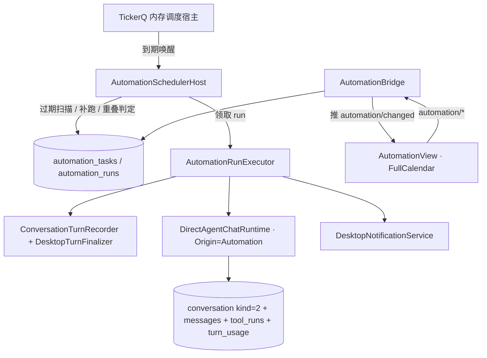

# 自动化模块（Automation）系统设计

> 状态：设计稿 v1.0
>
> 基线：当前仓库代码（schema v30、Direct 三 origin、无自动化实现）。
>
> 范围：单机单用户的"定时 LLM 任务 + 个人 todo"；不含多用户、云同步、跨设备、事件触发（文件变更/webhook）与外部系统日历同步。
>
> 本文只做设计决策的记录，不描述实施进度；实施清单与阶段验收见 `.scratch/automation/spec.md`。

---

## 0. 核心结论

自动化不是"聊天页的一个新入口"，而是一个独立模块：调度器负责"什么时候跑"，执行器负责"跑一个 headless Direct 回合"，UI 只读持久化结果。



模块的 seam 是三个入口：

| 入口 | 职责 | 删除它会发生什么 |
| --- | --- | --- |
| `IAutomationTaskService`（Core 契约 + Desktop 实现） | 任务保存校验与持久化副作用（重建调度 + 变更通知）、启停、删除（取消 → 限时等待 → 级联）、历史回收、历史体积查询 | 校验规则散进 bridge 与 UI |
| `AutomationSchedulerHost` | 注册/重建调度、过期扫描与补跑、重叠跳过、启动恢复、立即运行/取消、关闭收尾 | 时序与恢复逻辑散进 App 生命周期 |
| `AutomationRunExecutor` | headless Direct 回合、快照、审批策略、重试、终态与 usage | Direct 调用细节散进调度器与 bridge |

> 边界澄清（P4 定稿）：`立即运行`/`取消` 归 `AutomationSchedulerHost`（它拥有 run 生命周期与并发），`schedule 预览`与只读列表/日历投影留在 `AutomationBridge`（纯 wire 解析 + 纯计算，无校验规则）。`IAutomationTaskService` 只承载需要「校验 + 副作用」的任务级操作，因此不提供裸读方法。

三个**明确否掉**的替代方案（理由在对应章节）：

1. 复用 `ConversationTurnEngine` / `Origin=Interactive`：会污染交互调度、侧边栏与选中态（§4.1）。
2. 物化 occurrence 表：任务改期后产生悬空行，v1 收益不足（§3.3）。
3. 让 TickerQ 持久化调度状态（EF Core provider 或自写 persistence provider）：双真相 + 重型依赖，且它管不了 run 记录（§3.1）。

---

## 1. 需求映射

| 需求 | 设计要素 |
| --- | --- |
| 日历可视化定时任务/todo | FullCalendar v7 + host 侧触发点投影（§5.2） |
| 天/周/月/一次性定时任务 | `AutomationTaskKind` + `schedule_json` + NCrontab（§3.3） |
| 持久化，框架用 TickerQ | SelfClaw SQLite 为唯一真相；TickerQ 用内存 provider（§3.1） |
| 个人 todolist | 同一 `AutomationTask`，无 `Prompt` 无触发器 = todo（§2.1） |
| 复用后端 Direct | headless Direct 回合 + 新 origin（§4） |
| 自定义 system 提示词 / 选 skill / 选 MCP | 任务自持能力配置 + UI 预设复制（§4.3） |

---

## 2. 领域模型与数据库

### 2.1 单一实体：`AutomationTask`

一张表承载三种形态，用 `Kind` 与可空 `Prompt` 表达分支：

| 形态 | `Kind` | `Prompt` | 行为 |
| --- | --- | --- | --- |
| 纯 todo | `None` | NULL | 只勾选完成，不调 LLM |
| 手动 AI 任务 | `None` | 非空 | 只由"立即运行"触发 |
| 定时 LLM 任务 | `Once/Daily/Weekly/Monthly/Cron` | 非空（强制） | 到点执行 headless 回合 |

```csharp
public enum AutomationTaskKind { None = 0, Once = 1, Daily = 2, Weekly = 3, Monthly = 4, Cron = 5 }
public enum AutomationTaskStatus { Open = 0, Done = 1 }
public enum AutomationRunTrigger { Scheduled = 0, Manual = 1, CatchUp = 2 }
public enum AutomationRunStatus { Queued = 0, Running = 1, Completed = 2, Failed = 3, Cancelled = 4, Interrupted = 5, Skipped = 6 }
public enum AutomationRunSkipReason { Overlap = 0, Stale = 1 }
```

`schedule_json` 形状（带 `version` 便于演进，对齐 Subagent 快照做法）：

```json
{ "version": 1, "time": "09:30", "weekdays": [1, 3, 5], "dayOfMonth": 15, "runAtUtc": "2026-10-13T01:30:00+00:00", "cron": "*/15 * * * *" }
```

`next_run_at_utc` 是冗余列：日历/卡片/过期扫描都要按时间查，不能每次现算。写入时机只有三个——保存任务、run 终态、启动重建。

### 2.2 schema v31（破坏性升级）

`SqliteDatabase` 只接受恰好等于当前版本的库，**不迁移、不回填**。因此本次升级到 v31 意味着已有 v30 库会被明确拒绝打开（用户需删除本地库重建）。这是已确认接受的代价。后续 schema 已升至 v32（上下文压缩），本节保留 v31 时间点原文。

```sql
CREATE TABLE automation_tasks (
    id TEXT NOT NULL PRIMARY KEY,
    title TEXT NOT NULL,
    notes TEXT NOT NULL DEFAULT '',
    kind INTEGER NOT NULL CHECK(kind BETWEEN 0 AND 5),
    schedule_json TEXT NULL,
    next_run_at_utc TEXT NULL,
    prompt TEXT NULL,
    instructions TEXT NOT NULL DEFAULT '',
    tool_policy TEXT NOT NULL DEFAULT 'system',
    plugin_ids_json TEXT NOT NULL DEFAULT '[]',
    skill_ids_json TEXT NOT NULL DEFAULT '[]',
    mcp_server_ids_json TEXT NOT NULL DEFAULT '[]',
    model_profile_id TEXT NULL,
    workspace_root_id TEXT NULL,
    tool_permission_mode INTEGER NOT NULL DEFAULT 1,
    status INTEGER NOT NULL DEFAULT 0 CHECK(status BETWEEN 0 AND 1),
    completed_at_utc TEXT NULL,
    due_at_utc TEXT NULL,
    is_enabled INTEGER NOT NULL DEFAULT 1,
    last_run_at_utc TEXT NULL,
    last_run_status INTEGER NULL,
    created_at_utc TEXT NOT NULL,
    updated_at_utc TEXT NOT NULL,
    -- 有触发器就必须有提示词：不允许"到点了什么都不做"的僵尸任务
    CHECK(kind = 0 OR prompt IS NOT NULL),
    CHECK(kind = 0 OR schedule_json IS NOT NULL),
    FOREIGN KEY(workspace_root_id) REFERENCES workspace_roots(id) ON DELETE SET NULL
);

CREATE TABLE automation_runs (
    id TEXT NOT NULL PRIMARY KEY,
    task_id TEXT NOT NULL,
    conversation_id TEXT NULL,
    trigger INTEGER NOT NULL CHECK(trigger BETWEEN 0 AND 2),
    scheduled_for_utc TEXT NULL,
    status INTEGER NOT NULL CHECK(status BETWEEN 0 AND 6),
    skip_reason INTEGER NULL,
    attempt INTEGER NOT NULL DEFAULT 1,
    model_profile_id TEXT NULL,
    capability_snapshot_json TEXT NULL,
    workspace_root_id TEXT NULL,
    workspace_path_snapshot TEXT NULL,
    started_at_utc TEXT NULL,
    completed_at_utc TEXT NULL,
    error_code TEXT NULL,
    error_message TEXT NULL,
    created_at_utc TEXT NOT NULL,
    FOREIGN KEY(task_id) REFERENCES automation_tasks(id) ON DELETE CASCADE,
    FOREIGN KEY(conversation_id) REFERENCES conversations(id) ON DELETE CASCADE
);

-- 同一次触发最多一条 run：补跑重建、启动重建、并发领取都不能造出第二条
CREATE UNIQUE INDEX ux_automation_runs_scheduled
    ON automation_runs(task_id, scheduled_for_utc) WHERE scheduled_for_utc IS NOT NULL;
CREATE INDEX ix_automation_runs_task_created ON automation_runs(task_id, created_at_utc DESC);
CREATE INDEX ix_automation_runs_status ON automation_runs(status, scheduled_for_utc);
CREATE INDEX ix_automation_tasks_next_run ON automation_tasks(is_enabled, next_run_at_utc);
```

既有表变更一处：`conversations` 的 CHECK 扩展为

```sql
CHECK((kind = 0 AND parent_conversation_id IS NULL)
   OR (kind = 1 AND parent_conversation_id IS NOT NULL)
   OR (kind = 2 AND parent_conversation_id IS NULL))
```

配套代码变更：`ConversationKind.Automation = 2`、`SqliteConversationRepository.ValidateConversationOwnership` 增加分支、`SqliteSchema.RequiredTables` 增加两张新表。`ListConversationsAsync` 已经是 `kind = Interactive` 过滤，**自动化会话不会进入侧边栏**，无需改动。

### 2.3 转录归属

每个真正执行过的 run 拥有一条 `ConversationKind.Automation` 会话（`automation_runs.conversation_id`），消息/工具调用/token 全部复用现有 `ConversationTurnRecorder` 与 `turn_usage`。`Skipped` 的 run 没有会话。

- 级联方向：删任务 → 删 run → 删会话（转录随运行记录一起走）。
- 会话语义：`parent_conversation_id` 恒为 NULL，不参与子代理的 parent 校验。
- 手动删除单条 run 等于删除其会话，转录一并回收。

### 2.4 仓储与接口

领域契约放 `SelfClaw.Core/Interfaces/Automation/`，每条 1–5 个方法（遵循项目约定）：

```csharp
public interface IAutomationTaskStore          // 任务定义读写 + 调度字段
public interface IAutomationRunStore           // run 生命周期读写（含领取、终态、恢复扫描）
```

实现：`SelfClaw.Infrastructure/Data/Sqlite/Repositories/SqliteAutomationTaskRepository.cs`、`SqliteAutomationRunRepository.cs`。DTO 全部是 `record` 纯数据（`SelfClaw.Core/Models/Automation/`），一个文件一个 DTO。

---

## 3. 调度内核

### 3.1 TickerQ 边界

`TickerQ` 10.4.0（net10.0，cron 用 NCrontab）以**默认内存 provider** 使用，不引入 `TickerQ.EntityFrameworkCore`，也不自写 `ITickerPersistenceProvider`。

| 归属 | 职责 |
| --- | --- |
| TickerQ | cron 表达式解析、本地时区（`SchedulerTimeZone = TimeZoneInfo.Local`）、到期唤醒、函数级并发闸（`maxConcurrency`）、进程内退避 |
| SelfClaw | 任务的持久化与真理来源、`next_run_at_utc`、错过策略、重叠判定、run 记录、启动恢复、UI 查询 |

职责划分的硬边界：**TickerQ 里的一切都可丢，丢掉后从 `automation_tasks` 重建**。`RetryCount = 0`——重试完全归 `AutomationRunExecutor`（§4.5），避免两条重试路径互相打架。

宿主接线在 `DesktopServiceRegistration`：`services.AddTickerQ(...)` + `MapTicker("automation.run", ...)`，`App.StartAsync` 里 `_host.UseTickerQ()`（`TickerQStartMode.Immediate`）。`DisableBackgroundServices()` 不用——我们需要它自己的调度宿主。

### 3.2 注册与重建

启动与每次任务变更后，调度注册按以下规则收敛（幂等，可整体重建）：

| 任务状态 | 注册动作 |
| --- | --- |
| `is_enabled = 0` | 删除对应 cron ticker |
| `Kind = Cron/Daily/Weekly/Monthly` 且启用 | upsert cron ticker（表达式来自 `schedule_json`） |
| `Kind = Once` 且启用且 `next_run_at_utc > now` | 注册 time ticker（`scheduled_for_utc = next_run_at_utc`） |
| `Kind = Once` 且 `next_run_at_utc <= now` | 交给补跑/跳过判定（§3.4） |
| `Kind = None` | 不注册 |

cron ticker 的任务标识只带 `taskId`，执行时**重新读任务行**，不缓存配置。

### 3.3 触发点投影与下次触发

"下一次触发时间"只有一份实现，在 host（`AutomationScheduleCalculator`，Infrastructure，可单测）：

- 一次性 → `schedule_json.run_at_utc`
- 每天/每周/每月 → 组合成 NCrontab 表达式后计算
- cron → 直接计算
- 每月 29–31 日遇到短月 → 该次跳过（NCrontab 语义），保存时给出提示文案

日历的"未来触发点"同样是 host 计算：`automation/list-calendar` 只接收 `fromUtc/toUtc`，返回投影事件，**不在 JS 里重复 cron 语义**。表单的"下次触发"预览走 `automation/preview-schedule`。

投影是动态的：不建 occurrence 行。任务改期后日历立刻反映，不存在悬空记录。投影数量设上限（单次查询 ≤ 300 条），超出截断并返回 `truncated: true` 供 UI 提示。

### 3.4 错过、补跑与休眠

唯一规则（全局，不设开关）：启动/唤醒时对每个启用的任务计算"上一个应当触发的时间"。

| 情况 | 处理 |
| --- | --- |
| 距现在 **≤ 6 小时**（`MissedRunGrace`） | 补跑**一次**（`trigger = CatchUp`，`scheduled_for_utc` 取被错过的那次），多次错过合并为一次 |
| 距现在 **> 6 小时** | 写一条 `Skipped(Stale)`，不产生会话、不花 token |
| 机器休眠后定时器延迟唤醒 | 复用同一宽限规则；宽限内照常执行；超出记 `Skipped(Stale)` |

宽限期是常量而非配置项：先按数据调，不做 UI 旋钮。

### 3.5 并发与重叠

- 全局并发 **1**：`automation.run` 函数 `maxConcurrency = 1`，同一时刻只有一个自动化回合在跑。
- 同一任务**从不重叠**：到期时该任务已有 `Queued/Running` 的 run → 写 `Skipped(Overlap)` 并立即返回，**不排队堆积**。
- **同一触发点只有一条 run**（`ux_automation_runs_scheduled` 的语义），实现上有两条硬约束：
  - `automation_runs`/`automation_tasks` 的 `*_utc` 列一律以 **UTC 文本**持久化（`DateTimeOffset.ToUniversalTime().ToString("O")`）。唯一索引与去重查询按文本/瞬时比较，同一个瞬时如果被写成两种偏移（`10:30+08:00` 与 `02:30+00:00`）会被当成两次触发——ticker 拿到的是 UTC，扫描拿到的是 `next_run_at_utc`，两条路径必须同形。
  - 去重检查**先于**重叠判定：ticker 的 run 还在跑时扫描又看到同一个到期点，那是**同一次**触发，不能记成 `Skipped(Overlap)`。去重查询用 `datetime()` 缩小候选、再在内存里比较瞬时，既容忍历史上遗留的本地偏移写法，也不会把同一秒内的两个触发点合并。被去重拒绝的插入返回 `null`，调用方静默放弃，不发事件、不伪造记录（重叠行则必须真正插入成功才返回）。
- 与交互回合**不互斥**：用户在聊天不阻塞定时任务；资源竞争由"只有一路自动化"控制。
- 领取是事务性的：`Queued → Running` 用条件更新（`WHERE status = Queued`），配合 `ux_automation_runs_scheduled` 兜底。

### 3.6 启动恢复

`SqliteStartupRecovery` 只收敛 `origin = 0` 的 Running 回合，注释明确"Continuation 与 Subagent 由各自 owner 恢复"。自动化必须有自己的恢复（`AutomationStartupRecovery`，Infrastructure）：

```sql
-- 与 origin=0 的既有恢复同构，只换 origin=3（Automation）
UPDATE tool_runs SET status = 2, result_summary = COALESCE(result_summary, $toolSummary), updated_at_utc = $at
WHERE status IN (0, 3) AND message_id IN (
    SELECT m.id FROM messages m JOIN conversation_turns t ON t.id = m.turn_id
    WHERE t.status = 0 AND t.origin = 3);
UPDATE messages SET status = 2, updated_at_utc = $at
WHERE status = 1 AND turn_id IN (SELECT id FROM conversation_turns WHERE status = 0 AND origin = 3);
UPDATE conversation_turns SET status = 6, completed_at_utc = $at, error_message = $turnMessage
WHERE status = 0 AND origin = 3;

UPDATE automation_runs SET status = 5, error_code = 'ProcessInterrupted', completed_at_utc = $at
WHERE status IN (0, 1);   -- Queued / Running
```

中断的 run **本身不恢复**（对齐子代理纪律）：有工具执行证据时续跑可能重复副作用，所以既不动它的转录也不重放工具调用，只标 `Interrupted`。但恢复**不修改 `automation_tasks.next_run_at_utc`**，因此进程被杀造成的错过仍走同一个补偿判定：重启后若被错过的那次仍在 `MissedRunGrace` 内，补偿扫描会新建一条 `CatchUp` run（是新 run，不是恢复旧 run）；超出宽限则写 `Skipped(Stale)`。这是 v1 已确认接受的行为。

**顺序硬保证**：恢复必须早于任何 run 开始。`AutomationSchedulerHost.ExecuteAsync` 第一件事是执行恢复，并且 ticker 函数入口 `await _recoveryCompleted` 之后再执行——避免 TickerQ 的调度宿主先于我们注册完成时抢跑。

单实例前提：与现有子代理调度一致，不加跨进程锁；两个实例同开同一 DB 是既有未覆盖场景。

### 3.7 关闭

应用关闭走既有顺序（停受理 → 取消并等待活动 → 释放 UI → dispose）。自动化补两条：

1. `AutomationSchedulerHost` 的收尾里**取消所有在跑的 run**（`AutomationRunCancellationRegistry` 里的 `CancellationTokenSource` 集合）并限时等待（预算内，例如 5 秒），随后 TickerQ 宿主随 `_host.StopAsync` 停止。
2. 因应用停止而取消的 run 由 executor 收敛为 `Cancelled(ApplicationStopping)`（与 `SubagentTaskExecutor.FinalizeCancellationAsync` 的语义一致）；进程被强杀、连收尾都没跑到的 run 由下次启动恢复收敛为 `Interrupted(ProcessInterrupted)`（§3.6），转录里留下部分内容。**不把关闭当成删除**。

### 3.8 时区与 DST

- 一律本地时区；`SchedulerTimeZone = TimeZoneInfo.Local`，UI 直接展示本地日期时间（不再追加"（本地时间）"后缀——整页口径一致，后缀只是噪音）。
- 春季前跳：不存在的本地时刻不触发（NCrontab 语义）。
- 秋季回拨：重复的本地时刻只触发一次。
- 两条都要有单测锁住（§7 P1）。

---

## 4. 执行链

### 4.1 新增 `DirectTurnOrigin.Automation`

```csharp
public enum DirectTurnOrigin { Interactive = 0, Subagent = 1, Continuation = 2, Automation = 3 }
```

**必须同时修正 `DirectTurnPolicy`**：`IsDelegated` 当前定义为 `Origin != Interactive`，而 `AllowsSkill` / `AllowsMcpServer` 在委派态下只认 capability ceiling。若不改，自动化任务里选的 skill/MCP 会**静默消失**（不报错、无工具）。修正后语义：

| 规则 | Automation |
| --- | --- |
| capability 边界 | 与 Interactive 相同：以任务自持的 Agent 配置自我定界，无 ceiling |
| `RequiresCapturedCapabilities` | false（不要求父快照） |
| `ShrinksToCapturedCapabilities` | false（不因漂移失败） |
| `RequiresToolExecutionCheckpoint` | false（不参与 continuation） |
| `HasFreshUserMessage` | true（每次触发都是新的用户消息） |
| `CanDelegateToSubagent` | **false（v1 不委派）** |

这条修正必须有显式断言测试：**带 skill + MCP 的自动化回合，绑定出的工具列表非空且包含预期工具**。

其余不变量保持：`DirectAgentChatRuntime.SetupTurnAsync` 拒绝非 Interactive 回合携带 `InputSession/Steering`——自动化天然不带，符合现状。

### 4.2 `AutomationRunExecutor`

镜像 `SubagentTaskExecutor` 的结构（Desktop 侧，headless）：

```text
ExecuteAsync(run, task, cancellationToken)
  1. 解析并校验任务快照（model / capability / workspace）；失败 → run Failed + 错误码
  2. 事务：创建 conversation(kind=Automation) + turn(origin=Automation) + 用户消息
     run: Queued → Running，写 started_at_utc
  3. 构造瞬时 AgentRuntimeDefinition(Id = "automation:<taskId>")
  4. DirectChatTurnRequest(
       ...,
       ModelProfileId      = 任务模型（空值交由 factory 解析 desktop-default）,
       ToolPermissionMode  = FullAccess,
       ToolApprovalHandler = AutomationToolApprovalHandler,
       ExecutionContext    = new(DirectTurnOrigin.Automation, null, null))
  5. await foreach StreamTurnAsync → ConversationTurnRecorder.ApplyEventAsync + DesktopTurnFinalizer
  6. 终态：run status / error_code / completed_at_utc / usage；更新 task.last_run_* 与 next_run_at_utc
  7. 失败通知（§5.4）
```

`AutomationToolApprovalHandler` 是自动化专用实现，与 `DesktopToolApprovalHandler` **不共用**：立即返回 `Denied` 并记录"钩子强制审批"诊断，绝不挂起。返回的 `ToolApprovalPresentRequest` 语义仍然保留在转录里，用户事后能看到"哪一步因无人值守被拒"。

### 4.3 能力配置与快照

任务自持：`Instructions / ToolPolicy / PluginIds / SkillIds / McpServerIds / ModelProfileId / WorkspaceRootId`。**不引用** `{AppData}\agents\` 定义，避免"定义被改/删后任务行为漂移"。编辑器提供"从 Agent 预设填充"，把选中 Agent 的字段一次性复制进表单（UI 便利，零运行时耦合）。

run 启动时写入 `capability_snapshot_json`（当次使用的完整配置）+ `model_profile_id`（解析后的具体模型）+ `workspace_root_id`/`workspace_path_snapshot`。历史 run 的解释永不随任务编辑而失真。

- `WorkspaceRootId` 为空合法：此时没有文件/搜索/Shell 工具，只剩 MCP（现状 `DirectTurnCapabilityResolver` 在 workspace 为空时不创建 workspace 工具）。
- 模型被禁用/删除 → run `Failed(ModelUnavailable)`，**不静默回退默认模型**；任务卡片亮失败徽标，不自动停用。

### 4.4 审批策略：任务级 FullAccess

- **任何携带 `Prompt` 的任务（含一次性、周期与手动 AI 任务）都强制 `ToolPermissionMode.FullAccess`**，UI 上是显式确认项（"允许该任务在无人值守时读写文件并执行命令"）；纯 todo 无 `Prompt`，该字段无意义。手动 AI 任务虽然由用户点击触发，但执行路径与定时任务完全一致（headless），不做双份审批语义。
- 理由：需要审批的内置工具是 `write_file / edit_file / run_shell_command`，而**所有 MCP 工具都是 `RequiresApproval`**；在"只有 UI 能裁决、没有超时"的现状下，`RequireApproval` 的定时任务不是更安全，而是必然卡死。
- 钩子强制审批（`pre.ApprovalRequiredBy`）**连 `FullAccess` 也绕不过**，因此自动化统一走"立即拒绝 + 诊断"路径。
- 运行级墙钟超时兜底（默认 30 分钟，常量）：超时 → run `Failed(TimedOut)`。
- 安全决策前移到保存时的一次显式确认，运行时状态机因此不需要 `WaitingApproval`。

### 4.5 失败重试：只认"零工具证据"

| 情况 | 处理 |
| --- | --- |
| 无工具执行（`tool_runs` 为 0）且失败属 provider/网络/超时类 | 可重试：最多 3 次尝试，退避 10s / 30s |
| 已执行过任何工具 | 立即终态失败，不重试 |
| 模型不可用、skill/MCP 缺失、工作区不存在、工具连续故障达上限、钩子拒绝 | 立即终态失败 |
| 应用关闭导致的 `Interrupted` | run 本身不恢复（转录停在中断处）；若被错过的那次仍在 6h 宽限内，重启后的补偿扫描会**新建一条 `CatchUp` run**，超出宽限则 `Skipped(Stale)` |

重试不新建 run 行，只累加 `attempt`；每次重试**重新解析**模型与能力快照（不沿用上一轮失败时的解析结果）。退避用注入的 `TimeProvider`，便于单测。

### 4.6 终态与错误码

`AutomationErrorCodes`（`SelfClaw.Core/Runtime/Automation/`）：`TriggerRequiresPrompt`、`InvalidSchedule`、`IntervalTooShort`、`RunConflict`、`UnknownTask`、`UnknownRun`、`DeleteTimeout`、`ModelUnavailable`、`CapabilityUnavailable`、`WorkspaceUnavailable`、`ProviderFailed`、`TimedOut`、`ToolFaultLimit`、`ProcessInterrupted`、`CancelledByUser`、`ApplicationStopping`。

`Skipped` 用 `skip_reason`（`Overlap` / `Stale`）区分，`error_code` 保持 NULL。三种取消来源必须可区分：用户停止 `Cancelled(CancelledByUser)`、应用停止 `Cancelled(ApplicationStopping)`、进程中断 `Interrupted(ProcessInterrupted)`。UI 据此显示不同文案，与子代理错误码风格一致。

### 4.7 生命周期操作

| 操作 | 语义 |
| --- | --- |
| 编辑 | 随时可改；在跑的 run 用启动快照，不受影响；改触发器/时间只影响下次注册 |
| 停用 | `is_enabled = 0` 并删除 cron ticker；**不打断**在跑的 run |
| 立即运行 | 该任务已有 `Queued/Running` → 拒绝（`RunConflict`），不排队 |
| 停止本次运行 | 置取消请求 → executor 取消 → `Cancelled` |
| 删除任务 | 取消在跑的 run 并限时等待（30s）→ 删任务 + run + 会话级联；超时中止删除并提示（`DeleteTimeout`） |
| 删除单条 run | 已终态的 run 直接删（含会话）；在跑的必须先停止 |
| 清空历史 | 按任务或全局删除所有终态 run + 会话，保留任务定义 |

历史回收的实现边界：`IAutomationRunStore.DeleteTerminalRunsAsync(taskId?, runId?)` 只删终态 run，并在同一事务里删除其会话（消息/工具记录随会话级联，run 行再随会话级联）。`IAutomationTaskService` 只做语义分派与「取消 → 限时等待」编排；删除任务超时返回 `DeleteTimeout` 并保持任务与 run 原样（`is_enabled` 会被置 0，避免等待期间被重新排队——这不是删除，任务定义仍完整）。

---

## 5. 前端

### 5.1 组件结构

```text
views/AutomationView.vue                       只做编排（工具条 + 三块区域的组合）
components/automation/
  AutomationCalendar.vue                       FullCalendar 封装：投影、事件渲染、范围事件
  AutomationEventChip.vue                      eventContent：状态点/失败徽标/todo 勾选/运行中脉冲
  AutomationTaskPanel.vue                      右栏：清单页签 + 运行历史页签 + 范围/关键词筛选
  AutomationTaskDialog.vue                     新建/编辑：基础信息 + 触发器 + 能力配置 + 从预设填充
  AutomationRunDrawer.vue                      run 详情：元数据 + 只读转录
composables/useAutomation.js                   host 状态、日历范围查询、CRUD、事件订阅
renderers/automationEvents.js                  事件模型 → FullCalendar 事件（纯函数，可单测）
```

约定：一组件一职责、`<style scoped>`（FC 内部样式用 `:deep()` 收敛）、图标统一 `lucide-vue-next`、逻辑进 composable/纯函数、超过 ~300 行拆分。

**清单的范围**：清单页签默认只列**今天**的事项——`dueAtUtc` 落在今天或更早（更早且未完成 = 逾期，已完成的历史待办不再占位）、`nextRunAtUtc` / `lastRunAtUtc` / `completedAtUtc` 中任一本机日期等于今天。**「今天新建」本身不算今天**：今天建的、明天到期的待办属于明天，否则清单会变成一个不断膨胀的收件箱。没有截止日也没有调度的待办（含手动 AI 任务）始终留在清单里，未完成即一直可见——否则新建后立刻从清单消失，用户只能去「全部」找。判定是 `localDateKey` + `isTaskInDayScope` 纯函数，`AutomationView` 持有 `taskScope`/`todayKey` 并每分钟重算一次以便跨午夜翻页；「今天 / 全部」切换只影响右栏清单，日历与运行历史的查询口径不变。今天为空时由清单文案指向「全部」并给出被封存的任务数。卡片只显示「下次 / 上次」等状态，历史体积只在运行历史页签展示（任务卡片的「清空该任务历史」按钮仍按 `historyBytes` 显隐）。

### 5.2 日历

- **FullCalendar v7.1.1** + `@fullcalendar/vue3`：`daygrid`（月）、`timegrid`（周/日）、`list`（清单）、`interaction`（拖拽/框选）；`locales/zh-cn`；主题包（monarch 等）用我们的 CSS 变量覆盖 token。新增依赖：`@fullcalendar/vue3`、`temporal-polyfill`。
- 事件模型（host 返回，三种）：

```json
{ "kind": "projected", "taskId": "...", "atUtc": "...", "allDay": false, "title": "..." }
{ "kind": "todo",      "taskId": "...", "atUtc": "...", "allDay": true,  "status": "open|done", "isOverdue": true }
{ "kind": "run",       "runId": "...", "taskId": "...", "atUtc": "...", "status": "Completed", "durationMs": 42000, "tokens": 8123 }
```

- 交互边界：只有 `todo`（拖动 = 改截止日）与**一次性任务的投影**（拖动 = 改触发时间）可拖拽；**周期任务的投影与历史 run 一律不可拖拽**（避免"拖动一次周期任务到底改了什么"的歧义）。
- 点击空白格 → 打开新建对话框并预填该时间；点击事件 → 打开 run/任务详情。
- 投影上限 300 条，超出显示截断提示。

### 5.3 bridge 协议

`AutomationBridge.TryHandleAsync`（`type` 前缀 `automation/`）挂进 `WebViewMessageRouter`：

| 消息 | 请求 | 响应 |
| --- | --- | --- |
| `automation/list-tasks` | — | `{ tasks, historyBytes }`（每个 task 带 `historyBytes`） |
| `automation/list-calendar` | `{ fromUtc, toUtc }` | `{ events, truncated }` |
| `automation/list-runs` | `{ taskId?, status?, limit }` | `{ runs }` |
| `automation/get-run` | `{ runId }` | `{ run, transcript }` |
| `automation/save-task` | `{ task }` | `{ task, nextRunAtUtc, ok, errorCode? }` |
| `automation/preview-schedule` | `{ kind, schedule }` | `{ nextRunAtUtc, errorCode? }` |
| `automation/set-task-enabled` | `{ taskId, isEnabled }` | `{ task }` |
| `automation/run-task-now` | `{ taskId }` | `{ runId }` 或 `{ ok: false, errorCode: "RunConflict" }` |
| `automation/cancel-run` | `{ runId }` | `{ run }` |
| `automation/delete-run` | `{ runId }` | `{ deleted }` / `{ ok: false, errorCode: "RunConflict" }` |
| `automation/clear-task-history` | `{ taskId }` | `{ deleted }` |
| `automation/clear-history` | — | `{ deleted }` |
| `automation/delete-task` | `{ taskId }` | `{ ok }` / `{ ok: false, errorCode }`（超时为 `DeleteTimeout`） |
| `automation/get-settings` / `automation/set-settings` | `{ notifyOnSuccess }` | `{ settings }` |

- `transcript` 直接产出 `TranscriptPanel` 可消费的 `items` 形状（host 侧复用 `TranscriptProjection`），**前端不再为 run 详情写第二套渲染**。
- `historyBytes` 是 SQL `LENGTH()` 的只读粗算（每任务 + 全局总量），前端只在运行历史页签与任务卡片展示，不参与任何写入路径。
- "从 Agent 预设填充"复用现有 `agents/` bridge，不新增消息。
- 推送事件：`automation/changed { reason, taskId?, runId? }`（任务增删改、run 状态迁移、调度触发时发；回收后发 `run-deleted` / `history-cleared` / `task-deleted`）；通知激活时 `automation/open-run { runId }`。

### 5.4 实时性与通知

- **粗粒度事件 + 重拉**：收到 `automation/changed` 后按当前可视范围重拉日历 + 清单；页面激活/窗口聚焦补拉一次。不做增量 patch，不做流式转录。
- run 详情是静态快照 + 状态徽标；run 终态时收到事件自动刷新。
- **通知**：失败必通知（含重试耗尽与 `Interrupted`）；启动恢复标记为 `Interrupted(ProcessInterrupted)` 的 run 也会在恢复后逐条通知（宿主空时 `ShouldShowNotification` 放行）；成功通知默认关闭，`automation/set-settings` 可开；`Skipped` 不通知。通知器为 Desktop `AutomationRunNotifier`，由 `AutomationSchedulerHost` 在 run 终态与启动恢复后调用。
- 新增 `DesktopNotificationArguments.OpenAutomationRunAction` + `taskId`/`runId` 键；`DesktopNotificationActivationService` 增加分支：还原窗口 → `MainWindowViewModel` 切换到自动化视图 → 推 `automation/open-run`。自动化**不复用**"打开会话"动作（自动化会话不是交互会话）。

---

## 6. 语义默认值（v1 冻结）

1. 有触发器但无 `Prompt` → 保存被拒（`TriggerRequiresPrompt`）。
2. 有 `Prompt` 无触发器 → 手动 AI 任务，只由"立即运行"触发；完成态由用户勾选。
3. 一次性任务：成功 → 自动 `Done` + `completed_at_utc`；失败 → 保持 `Open`、不再自动触发、不因重启重跑。
4. 周期任务：`status` 恒为 `Open`，不显示勾选框；卡片显示"下次触发 + 上次结果"。
5. `due_at_utc` 只服务 todo；过期显示"逾期"样式，不自动完成、不自动删除。
6. 标题必填（≤120 字符）；`instructions` 可空；`prompt` 多行。
7. 触发器最小间隔 5 分钟：cron 计算出的相邻触发间隔 < 5 分钟 → 保存被拒（`IntervalTooShort`）。
8. 任务数量不设上限。

---

## 7. 阶段划分与验收

| 阶段 | 内容 | 验收 |
| --- | --- | --- |
| **P1 存储与调度内核** | schema v31、两张新表 + 仓储、`AutomationScheduleCalculator`、补跑/重叠/启停/恢复、TickerQ 宿主接线 | 单测：cron 投影与下次触发、DST 两侧、短月、周多选、宽限边界、合并补跑、`Skipped(Overlap/Stale)`、注册重建幂等、`UNIQUE(task_id, scheduled_for)`、恢复标记、仓储 CRUD |
| **P2 执行链** | `Origin.Automation` + `DirectTurnPolicy` 修正、`AutomationRunExecutor`、`AutomationToolApprovalHandler`、重试规则、快照、终态/usage | 单测：**skill/MCP 不被静默剔除的显式断言**、审批自动拒绝（含钩子）、零工具证据才重试、有证据不重试、取消/超时终态、run 快照内容、usage 落账 |
| **P3 前端** | `AutomationView` + 日历 + 右栏 + 对话框 + 抽屉、`AutomationBridge`、`automation/changed` 推送、通知动作 | Vitest：投影渲染、清单筛选、表单校验（无 prompt 拒、<5 分钟拒）、下次触发预览、抽屉复用 `TranscriptPanel`；Playwright：页面可达 → 建任务 → 日历出现事件 → 打开 run 抽屉 |
| **P4 收尾** | 手动删除/清空历史/体积显示、失败通知接通、文档同步、全量回归 | 全量 `dotnet test` + `npm test` + `npm run test:e2e`；`docs/` 与 `AGENTS.md` 指针同步 |

P1/P2 不合并：内核与执行必须能被分开定位。P3 只需 P1 的 bridge 契约即可开工（用构造的 run 数据）。

---

## 8. 明确不做

| 项 | 结论 |
| --- | --- |
| 物化 occurrence 行 / 重复待办自动生成 | v2（届时给 occurrence 建表，`automation_tasks` 不需回改） |
| 运行中流式转录 | v2（需要第二条带重放的推送通道） |
| 任务级工具白名单（auto-approve 列表） | v2 |
| LLM 操作任务（只读工具如 `list_today_todos`） | v2，且必须走"新增工具来源 + `ToolPolicy`/审批裁剪"的正规入口 |
| LLM 创建/修改任务（CRUD 工具） | 暂不考虑（递归触发 + 审批归属问题） |
| 自动化与交互回合互斥 | 不做（用户在场不应导致任务不跑） |
| N 次失败自动停用 | 不做（避免静默自残行为） |
| 事件触发（文件变更 / webhook / 频道消息） | 不在 v1 范围 |

---

## 9. 风险、假设与待测量

| 项 | 说明 |
| --- | --- |
| v30 → v31 破坏性 | 已确认接受；已有本地库需删除重建，`SqliteDatabase` 会明确拒绝而不是损坏 |
| 转录永久保留 | 已确认选择不做自动清理；回收手段是手动删除。**磁盘增长是本设计最大的长期风险**，MCP 单次结果上限 64KB，日更任务年增可达 GB 级；P4 已提供每任务/全局体积显示（SQL `LENGTH()` 只读粗算，不改 schema）与手动回收入口 |
| 单实例 | 与现有子代理调度一致，不加跨进程锁 |
| TickerQ 版本面 | 只依赖公开的 `AddTickerQ`/`MapTicker`/`ITimeTickerManager`/`ICronTickerManager` 与默认内存 provider；**不实现其内部 persistence 接口**，升级风险可控 |
| 前端版本面 | FullCalendar v7 需 `temporal-polyfill` 与 `preact` peer（离线可用）；v7 的 Sub-Path 插件与主题随 Vue 适配器发布，版本自洽 |
| 待测量 | 300 条投影上限对月视图的渲染开销；自动化 run 与交互回合并存时 provider 的限流表现；DB 体积增长曲线 |

---

## 10. 验证入口

```powershell
$env:DOTNET_CLI_HOME = 'D:\Repositories\SelfClaw\.dotnet'
$env:DOTNET_SKIP_FIRST_TIME_EXPERIENCE = '1'
$env:DOTNET_NOLOGO = '1'
dotnet restore SelfClaw.slnx --force-evaluate
dotnet build SelfClaw.slnx
dotnet test SelfClaw.Tests/SelfClaw.Tests.csproj

cd SelfClaw.TranscriptVue
npm test
npm run test:e2e
```

桌面/进程强杀 smoke 需 `SELFCLAW_DESKTOP_SMOKE=1`；真实 provider smoke 需 `SELFCLAW_PROVIDER_SMOKE=1` 且启用一个具备推理能力的模型。
