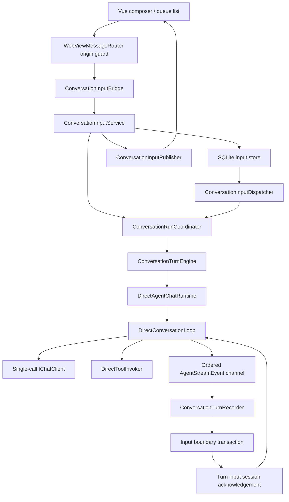

# Direct 消息队列与 Steer 设计

状态：P0/P1 保留已验收基线；P2 独立审核通过（IR-P2-01 测试夹具竞态已修复，6 次全量稳定 1419/0/4）。P3（持久化 Queue）独立审核发现的问题已修复并通过自动回归；P4（Steer 执行语义与竞争处理）实现与自测完成，独立审核发现的末尾竞争与显式 Skill token 问题已修复（.NET 全量 1542/0/4），**待独立复审**；P5（完整 Vue 交互和传输恢复）实现与自测完成（.NET 1549/0/4、Vitest 126、Playwright 25、Vue build 通过），独立审核 IR-P5-01 已修复并由原探针 22/22 复核。队列与 steer 始终开启（功能开关已在 `8ad27da` 删除，见 §11），P6 未实施。更新：2026-10-08。P2 基线提交 ca42646，当前目标 SQLite schema v30（P3/P4/P5 未新增 DDL）。P2 独立审核见 [P2 独立审核](direct-message-input-p2-independent-review.md)，P3 实施见 [P3 实施报告](direct-message-input-p3-implementation-review.md)，P4 实施见 [P4 实施报告](direct-message-input-p4-implementation-review.md)，P5 实施见 [P5 报告](direct-message-input-p5-implementation-review.md) 与 [P5 独立审核](direct-message-input-p5-independent-review.md)。

本文定义完整目标行为；P2 基础、P3 Queue 受理/调度已实现，P4 Steer 执行语义与竞争处理已实现、待独立审核（功能开关已删除，Queue 与 Steer 始终开启），P5 Vue 完整交互与传输恢复已实现、待独立审核。UI 调整（2026-10）：composer 只保留一个角落按钮，空闲即发送；Direct 忙碌时输入框有内容则同一按钮变成发送（入队）、为空则显示「停止生成」（不可停止的后台续跑显示进度）；steer 只在队列面板对 Pending FollowUp 点「调整当前任务」（promote），不再由 composer 直接提交 steer。实际实现及验证见 [P2 实施报告](direct-message-input-p2-implementation-review.md)、[P4 实施报告](direct-message-input-p4-implementation-review.md) 与 [P5 报告](direct-message-input-p5-implementation-review.md)。配套任务、用例和证据记录见 [分阶段实施与验收](direct-message-input-implementation.md)。现有机制参见 [运行链路](runtime-execution-flow.md)、[用量归一化](usage-tracking-design.md) 和 [Subagent 设计](direct-subagent-system-design.md)。

P1 的用量归一化边界已统一：TurnUsage.TotalTokens=null 明确为未知，生产方负责推导，共享累加器和 recorder 只合并并保留该语义；CLI 也在 parser 发出事件前归一化。P2 的回合模型与存储重构应继续沿用这一契约，不重新引入消费端 total 回退。

技术证据见 [P0 基线与复审报告](direct-message-input-p0-baseline.md) §10。已补齐两轮工具往返、第二次 HTTP 请求序列化和确定性屏障；修复 Chat Completions 出站 reasoning 丢失及 Responses 原生 function item 丢失。下文仍包含后续阶段的目标行为，不把离线合成 fixture 等同于真实 provider 验证。

数据前提（2026-10-02 确认）：本功能完成后由用户统一清理旧数据，按新 schema 初始化使用。不实现旧格式数据搬迁、字段回填或兼容读取；开发和验收使用当前阶段 schema 创建的测试数据。CLI、Subagent、continuation 是当前仍在使用的执行链路，仍需适配新模型并验证功能正确性。本次文档修订不执行数据清理。

## 0. 设计原则与本轮审查结论

架构原则：必要时直接重构现有职责、数据模型和调用边界，以清晰、可维护的最终结构为目标。现有类、字段和接口不是必须保留的约束；每个新增模块都要说明接管了哪项职责、替换了哪条路径。不得为少改文件而保留重复状态机，也不为本功能建立无实际消费者的通用框架。

本轮审查作出以下修订，取代此前文档中的对应方案：

| 发现的问题 | 最终设计决定 |
| --- | --- |
| 用首条 assistant 同时表示消息、逻辑回合和用量锚点，迫使空消息移位和特殊状态判断 | 新建 conversation_turns；TurnId 与所有 MessageId 独立，状态和 usage 归回合 |
| 允许继续扩展 Engine 的准入 gate，且 SessionCoordinator 已持有另一套启动锁和运行注册 | 必须抽取 ConversationRunCoordinator，统一准入及活动运行所有权；Engine 只执行已准入回合 |
| Queue 先按旧消息结构落地，之后再替换持久化语义 | 先完成目标回合模型、准入和事务基础，再交付 Queue，不制作一次性过渡模型 |
| input writer、finalization writer 和 continuation writer 容易分别实现相同消息／工具写入 | 重构为同一个事务内 writer，由不同用例选择事务边界；禁止相互嵌套独立提交 |
| boundary ACK 容易扩展成另一套投递、重试和恢复系统 | 仅保留一个进程内、有界、顺序提交屏障，复用输入消费事实确认结果 |
| 预留附件字段、双 provider 循环或双发送入口会形成长期遗留 | 首版只定义实际使用的文本输入；替换后删除无消费者的适配与重复路径 |

本文保留必要的跨模式行为约束，不冻结旧的内部实现形状。所有架构决策均需在实施文档中通过职责审查和删除清单验收。

## 1. 目标与范围

在 Direct Interactive 会话执行期间继续接收用户输入，支持两种明确不同的意图：

- **Queue / FollowUp**：当前回合成功收尾后，按顺序为每条输入启动独立回合。
- **Steer**：绑定当前逻辑回合，在安全边界追加用户消息，让同一回合重新决策。

采用每会话持久化输入队列、Desktop 统一准入、Direct 显式模型／工具循环。一个逻辑回合可以包含多条 assistant 消息；一个回合只有一次生命周期、一次终态和一份聚合用量。

首版输入 DTO 只定义文本字段。含附件提交在附件持久化接入前明确返回 `UnsupportedAttachments`，不得静默丢弃；附件接入时再增加真实模型及清理职责。CLI 保持既有用户行为和子进程执行语义，内部准入与回合存储一并重构；Subagent child 不开放用户输入；父会话执行 detached continuation 时，新输入进入 FollowUp 队列，不注入 continuation。

首版不取消正在读取的 provider 流，不抢占已经进入执行阶段的工具，不热切换模型、Workspace Root 或能力集合。后续若实现 HTTP 流抢占，另行设计不完整工具参数、推理签名和取消费用的处理。

## 2. 当前接入点与需要改变的假设

以下路径相对仓库根目录，均为现有源码；第 4 节中的新增名称是拟定名称。

| 位置 | 当前行为 | 目标变化 |
| --- | --- | --- |
| `SelfClaw.TranscriptVue/src/composables/useChatComposer.js` | `session.isBusy` 时不提交 | Direct 忙碌时提交到输入服务 |
| `SelfClaw.Desktop/ViewModels/MainWindowViewModel.cs` | 捕获选择、准备 Workspace Root、请求准入 | 保留空闲准备入口；繁忙输入绑定明确会话，不重新准备工作树 |
| `SelfClaw.Desktop/Services/Runtime/ConversationTurnEngine.cs` | 同时拥有准入、删除屏障及回合执行 | 准入移交 ConversationRunCoordinator；Engine 只执行已准入回合 |
| `SelfClaw.Desktop/Services/Runtime/ConversationSessionCoordinator.cs` | 选择／加载之外还持有运行注册及启动锁 | 保留选择、历史加载和展示；活动运行只读新的唯一注册源 |
| `SelfClaw.Infrastructure/AiProviders/AiChatClientFactory.cs` | `UseFunctionInvocation` 驱动内部工具循环 | Direct 获得单次调用的 provider 管线 |
| `SelfClaw.Infrastructure/Agents/Direct/DirectAgentChatRuntime.cs` | 一次 SDK 枚举、事件翻译、终态处理 | 将迭代控制交给显式 `DirectConversationLoop` |
| `SelfClaw.Infrastructure/Agents/Direct/Tools/DirectToolInvoker.cs` | SDK `FunctionInvocationContext` 入口，统一审批／checkpoint | 提取可直接调用的入口，保留唯一工具执行边界 |
| `SelfClaw.Desktop/Services/Runtime/ConversationTurnRecorder.cs` | `TurnId` 同时是 assistant ID 和工具所属消息 ID | 区分逻辑 TurnId 与当前 AssistantMessageId |
| `SelfClaw.Infrastructure/Agents/Direct/Context/DirectPromptComposer.cs` | 回合开始时构造预算内历史 | 提供可复用预算选择规则，支持运行中追加输入 |
| `SelfClaw.Infrastructure/Data/Sqlite/Repositories/SqliteConversationRepository.cs` | 按 `created_at_utc` 排消息 | 按持久化会话序号排序 |
| `SelfClaw.Infrastructure/Data/Sqlite/Repositories/SqliteUsageStatisticsReader.cs` | `turn_usage.message_id`；child 按 `child_turn_id` 关联 | 改为 turn_usage.turn_id，child 直接关联逻辑回合 |

不能让 Vue 直接修改 `ConversationRuntimeState.Messages`，不能在 UI 线程往 provider 正在枚举的消息列表中追加，也不能把尚未消费的队列输入提前写成正式用户消息。

## 3. 用户行为契约

### 3.1 操作语义

| 操作／情形 | 行为 |
| --- | --- |
| 空闲、无待执行项时发送 | 经过同一输入受理与消费事务，立即启动 |
| Direct 忙碌时普通发送 | 默认 FollowUp，与空闲发送共用同一个「发送」按钮并入队（不再单独提供「加入队列」按钮）；输入框为空时该位置显示「停止生成」，输入内容后切换为「发送」 |
| 空闲但已有可执行队列 | 新输入追加队尾，不越过已接受项 |
| 把 Pending FollowUp 提升为 Steer（唯一 steer 入口） | 精确绑定当前活动回合 `targetTurnId`，原子修改原项，保留 inputId 和 sequence；成功后该项显示“等待生效” |
| 提升时目标回合刚关闭或已不存在 | 不改写该项，返回 `TargetTurnClosed`；不注入后来启动的另一个回合 |
| 提升时运行的是 continuation／CLI／已关闭 steer 入口 | 不改写该项，返回对应原因（`ContinuationActive`／`DirectOnly`／`TargetTurnClosed`） |
| 当前回合成功且终态已提交 | 自动启动下一个 FollowUp |
| Failed / Blocked / Truncated，或非用户发起的 Cancelled，或终态落库失败 | 暂停该会话队列，不自动启动**已在队中的**下一项。若暂停后队列为空，下一次空闲发送仍立即启动，并在领取时解除暂停 |
| 停止生成（用户取消当前回合） | 丢弃全部未开始的队列项（Pending／Held 转 Cancelled），队列保持未暂停并关闭本轮 steer 入口，再取消当前回合；下一次空闲发送立即启动，不需要手动恢复。若取消过程中终态落库失败，仍按上一条暂停并显示失败原因 |
| 暂停队列 | 只暂停新的 FollowUp；不撤回已经接收的 steer，不取消当前执行 |
| 恢复队列 | 允许 Pending FollowUp 调度；Held 项仍需明确处理 |
| 编辑／删除 | 只允许尚未领取的项，必须匹配 revision |
| 将 Queue 提升为 Steer | 原子修改原项，保留 inputId 和 sequence，不复制一份输入 |

用户可以在暂停状态下继续入队。输入存在 Held 阻塞项时不能自动越过它执行后续项；用户可编辑并重试、转 FollowUp 或取消该项。不同会话仍可独立推进。

### 3.2 “生效”的精确定义

- `Accepted`：输入已经持久化，可在 WebView 重载后恢复。
- `Claimed`：输入被当前执行路径独占，不能再编辑或撤回。
- `Consumed`：正式用户消息及消费位置已提交，runtime 可以据此构造后续请求。
- UI 对 steer 的 Consumed 文案使用“已加入上下文”，不声称 provider 已收到或已遵守。

这些状态均不代表任务成功。任务结果由逻辑回合终态表示。

### 3.3 边界与批次

steer 可以在初始化、模型流式输出或工具执行期间排队；消费发生在首个 provider 请求前，或一个模型响应及其全部工具结果闭合后。一次领取截至当前高水位的 Pending Steer，按 sequence 顺序保留为独立 user 消息。之后到达的输入留给下一个边界，不能无限扩大正在提交的批次。

领取与正式消费是两个时点：如果 steer 将先撤销审批或跳过工具，必须先持久化领取本批输入，使其不可编辑／取消，再产生这些影响；到安全边界才提交 user 消息并标记 Consumed。没有提前影响时在边界领取。禁止先跳过工具、随后又允许用户删除造成该影响的输入。

检查末尾队列与关闭 steer 接收入口必须是同一临界区。成功关闭以后到达的输入转 FollowUp；关闭以前接受的 steer 必须被消费或明确转 Held，不能静默遗失。

## 4. 分层与所有权



| 模块（拟新增或改造） | 职责与约束 |
| --- | --- |
| Core `Models/Conversations/`、`Models/ConversationInputs/` | ConversationTurnRecord、输入、批次与结果 DTO；一文件一类型、无服务逻辑 |
| Core `Interfaces/Conversations/`、`Interfaces/ConversationInputs/` | 按真实跨项目调用定义回合读写、输入存储与运行输入契约；单接口 1–5 方法，不为每个类机械配接口 |
| Infrastructure `Data/Sqlite/Repositories/SqliteConversationInputRepository` | 输入持久化、条件更新、恢复查询 |
| Infrastructure `SqliteConversationTurnWriter` | 重构现有 SqliteTurnFinalizationWriter；共享回合／消息／块／工具／usage 的事务内写入，见 §5.5 |
| Desktop `Services/ConversationInputs/ConversationInputService` | 受理、编辑、取消、模式转换、快照和幂等 |
| Desktop `ConversationRunCoordinator` | Interactive 会话唯一的运行注册、准入、取消／完成句柄和删除屏障；服务 Direct、CLI、continuation |
| Desktop `ConversationInputDispatcher` | 发现候选、请求准入并执行、等待结果后唤醒下项；不再自行拥有 busy 表或终态状态机 |
| Desktop `DirectTurnInputSession` | 当前 run handle 的进程内输入控制端；一个提交 waiter、steer 批次通知及原子执行许可，不另建运行注册或完整工具状态机 |
| Desktop `ConversationTurnEngine` / `ConversationSessionCoordinator` | 前者执行、归约及调用提交策略；后者选择、加载及展示；均不再次裁决准入 |
| Desktop `ConversationInputBridge` / `ConversationInputPublisher` | 关联响应、选中会话状态订阅、版本和重载恢复 |
| Infrastructure `Agents/Direct/DirectConversationLoop` | provider 调用、工具批次、steer 边界、调用预算 |
| Infrastructure `Agents/Direct/Context/DirectConversationContext` | 有真实追加／裁剪行为的运行上下文服务；只有主循环可修改；与历史 composer 共用预算规则 |

`DirectChatTurnRequest` 增加可选 Core 输入会话契约，只给 Interactive Direct 绑定。不得把 Desktop 类型、SQLite 连接或 SDK `ChatMessage` 放进跨层 DTO。

输入队列以 SQLite 为事实来源；内存索引和唤醒 Channel 仅用于调度，丢失唤醒可通过启动扫描和有界周期扫描恢复。不能将 Subagent Delivery mailbox 与用户输入队列合并，两者重试及提交语义不同。

活动运行注册持有 ConversationRuntimeState 的唯一引用及生命周期句柄；SessionCoordinator 读取该对象生成选中快照，不复制一份可写 running 状态。Subagent child 的生命周期仍由其专用执行 session 管理，不再同时登记一套 Interactive 调度状态。Core 不引用 Desktop／Infrastructure，Infrastructure 不回调具体 Desktop 类型。

## 5. 持久化模型

### 5.1 输入表

拟新增 `conversation_inputs`：

| 字段 | 约束／含义 |
| --- | --- |
| `id` | PK；host 生成 inputId |
| `conversation_id` | FK conversations，级联删除；仅 Interactive 所有者 |
| `client_request_id` | UNIQUE(conversation_id, client_request_id)，受理幂等键 |
| `sequence` | UNIQUE(conversation_id, sequence)，单调递增且不复用 |
| `kind` | FollowUp / Steer |
| `target_turn_id` | Steer 必填；转换 FollowUp 后清空 |
| `payload_json` | 版本化正文载荷；不存完整历史、密钥或凭据 |
| `execution_snapshot_json` | FollowUp 的执行选择快照及格式版本 |
| `status` | Pending / Claimed / Consumed / Held / Cancelled |
| `revision` | 每次修改递增；条件更新版本 |
| `claim_id`、`claim_owner_run_id` | 本次领取及进程实例；不复用旧领取 |
| `consumed_turn_id`、`message_id` | 消费后填入；一项对应一条正式用户消息 |
| `created_at_utc`、`updated_at_utc`、`consumed_at_utc` | 审计时间，不作排序依据 |
| `reason_code`、`error_message` | 转换、暂停或失败原因，避免依靠 UI 文案判断状态 |

索引覆盖 `(conversation_id, status, kind, sequence)`；`message_id` 非空时唯一。`consumed_turn_id`、`message_id` 分别引用 conversation_turns 和 messages，Consumed 必须同时具有两者，且同属输入会话；消息不反向引用 input，避免循环归属。conversations 是级联删除根，删除路径在事务测试中验证。

`conversation_input_state` 每会话一行：`conversation_id`、`next_input_sequence`、`queue_revision`、`paused`、`pause_reason`。暂停必须落库，不能只保存在 Vue。所有队列状态变更与 queue_revision 递增同事务提交。

同一 requestId 携带不同正文／目标／模式时返回 `RequestConflict`；不能把旧 ACK 当成新输入成功。首版保留输入行用于去重直至删除会话，终态项不在待发送列表中展示；若后续增加新系统运行期间的定期清理，必须保留幂等凭证并单独定义保留期。这与上线前统一清理旧格式数据是两件事。

### 5.2 执行快照

FollowUp 固定提交时的 Agent 定义快照／revision、Direct 模式、具体 modelProfileId、Workspace Root ID 与路径、ToolPermissionMode。默认模型在受理时解析成具体 ID，但不提前创建 provider／MCP 连接或解密凭据。

执行前重新验证会话所有权、Agent 可用性、模型启用状态、Workspace Root 是否仍匹配及存在。Agent 定义改变时进入 Held，由用户重试时明确重新捕获，不静默使用另一份定义。Plugin／Skill／MCP 仍遵循 Interactive 的启动时解析规则；输入快照不长期持有版本 lease。显示并记录启动时采用的实际能力。

新会话的空闲提交仍经 VM 捕获选择和工作树准备，再使用稳定 conversationId 受理；失败需沿用工作树清理规则。已经存在的队列只绑定该会话的物理 Workspace Root，不在出队时读当前 UI 选择或创建第二个 Managed Worktree。

steer 使用运行回合的有效设置。需要换模型、Agent、Workspace Root、权限或显式激活 Skill 的输入转 FollowUp；不在回合中重新 Resolve 全部能力。

### 5.3 状态机与事务

```text
Pending --条件领取--> Claimed --消费事务--> Consumed
   |                     |
   +--> Cancelled        +--> Held（恢复或提交失败）
   +--> Held
Held --用户编辑/重试并重新校验--> Pending
Held --用户取消--> Cancelled
```

Consumed 是不可撤回的消费事实。取消正在执行的回合不把它改回 Pending。重试已消费输入必须创建新的 requestId / inputId，让重复执行可见。

FollowUp 的消费事务至少包含：匹配 claim、创建 Running 的 conversation_turns 行、写所属 user 消息、标记输入 Consumed。此时不创建空 assistant 占位。事务成功前禁止 provider 请求及工具执行；用回合开始提交替换 `AddUserMessageAsync` 的独立写入，不在调用后再补一遍 user。

steer 的消费事务见第 8 节。所有事务失败都保持前一份可解释状态，不允许出现“Consumed 但没有对应 user 消息”。

### 5.4 容量基线

- 每会话最多 20 个 Pending / Claimed / Held 输入；全应用最多 500 个。
- 单条正文最多 64 KiB UTF-8；超过模型预算仍需另行报错，字节上限不等于 token 预算。
- 状态快照最多 256 KiB UTF-8；列表只给最多 200 字符预览，编辑通过独立 detail 请求读取正文。
- 容量检查与受理同一临界区及事务；不丢弃最老项腾空间。

上述值是首版工程基线，实施时通过集中常量表达，验收必须覆盖精确边界。

### 5.5 统一回合写入与事务边界

重构现有单 assistant 的 `TurnFinalization` / `RecordedTurnCommit`，使其承载逻辑回合、需要落库的消息片段、工具及回合用量。消息内容归约仍由 recorder 完成；SQL writer 不接收流事件，也不重做归约。

定义三种明确提交用例：开始回合、消费输入边界、终结回合。其 repository 在一个事务中组合 `SqliteConversationTurnWriter` 的事务内操作与输入条件更新；writer 只使用调用方传入的 connection / transaction，不自开另一个事务，也不调用 repository 形成循环。

continuation 的 delivery repository 继续拥有“终态 + Delivered/DeadLetter”的事务，把相同 turn commit 交给同一 writer。它不通过普通 Interactive finalizer 提前提交。这样共享写入规则，同时保留各用例真实的原子边界；不新增一个泛化工作流框架或通用 UnitOfWork 层。

## 6. 准入、优先级与生命周期

### 6.1 唯一裁决点

必须将 Engine 的 `_turnAdmissionGate`、删除 tombstone、运行关闭与 SessionCoordinator 的启动裁决整合到 `ConversationRunCoordinator`。它按会话串行裁决：输入受理／转换、领取与运行注册、关闭 steer 入口、stop、删除屏障、continuation 准入。Engine 和 SessionCoordinator 移除各自独立的准入判断与启动锁；不能保留两套逻辑再互相转发。

每会话的短临界区允许有界的状态事务，不允许等待 provider、工具、审批、recorder ACK、历史加载或运行任务完成。先预留明确 run handle，再在锁外准备和执行；失败由同一 owner 释放预留。全局只保留关闭入口和容量计数等必要协调，全局容量仍以 SQLite 事务检查为准，不用一个全局大锁串行所有会话 I/O。句柄持有 claim 和运行所有权，不长期持有 semaphore。

数据库成功后再更新只读内存投影并发通知；通知丢失通过重读恢复。锁顺序固定为会话裁决 → 输入／工具调度状态；provider、工具和 recorder 不能持有自己的锁再反向等待会话裁决。审批 handler 仅裁决 Approved / Denied / Superseded；它不决定运行所有权或直接启动工具。

模型可用性读取和耗时准备可以在锁外做，但进入裁决点时必须重新校验所依赖的 conversation／input revision。准备失败不能遗留永久 busy 的 admission。

### 6.2 调度顺序

同一会话至多一个运行所有者。空闲时 FollowUp FIFO；忙碌时只有绑定当前 turn 的 Steer 走输入会话。新普通发送不能绕过已有 Pending / Held 项。

将 `GetUnavailableContinuationParents` / `TryAdmitContinuationAsync` 的实际规则迁入 run coordinator，由 SubagentDeliveryDispatcher 直接使用该准入契约。删除 Engine 中的对应规则和 `_pendingInteractiveAdmissions`；用户优先级根据持久化未处理输入和活动预留判断，不保留一个跨会话的瞬时计数充当队列。

存在未处理用户输入（包括暂停、Held）时，不自动启动该父会话的 continuation，防止后台动作越过尚待处理的用户意图；其他父会话正常调度。暂停且无未处理输入时不额外改变原 continuation 行为。已在运行的 continuation 不因新 queue 被强制重放或改变 delivery lease。

dispatcher 使用受控后台任务和公平候选扫描；一会话失败不能阻塞全局队列。FollowUp 只在上一回合终态成功提交、运行资源释放并完成 coordinator 收尾后推进。最终回合结果与持久化结果须由引擎明确返回，不能只根据收到 `RunCompletedEvent(Succeeded)` 或 `IsRunning == false` 推断成功。

### 6.3 停止、删除和恢复

- stop 先持久化 paused、关闭 steer 入口，未消费 steer 进入 Held，再取消运行 token；不恢复已跳过工具。
- 删除先建立 tombstone、关闭输入入口和调度、取消／等待当前工作，再沿用 child 取消与级联删除；删除失败解除 tombstone 后保持 queue 暂停。
- 关闭应用先停止桥接受理和 dispatcher 领取，再取消回合、等待事件消费者和边界 waiter 退出，最后释放 DI。
- 启动恢复在 dispatcher 启动前运行：有未处理项的队列统一 paused；旧进程 Claimed 转 Held；绑定旧回合的 Pending Steer 转 Held。
- Consumed 不自动再执行；若所属回合未收尾，标记逻辑回合 Interrupted，保留已提交消息与用量。用户决定如何继续。

输入去重和消费事务只能保证本地不会重复消费一项；不保证 Shell、文件或 MCP 外部副作用 exactly-once。首版不通过“工具记录为空”推断可以自动重跑。

## 7. 显式 Direct 循环

### 7.1 单次 provider 管线

将自动函数调用从 Direct provider factory 移出，保留 adapter、日志过滤和 lease 释放顺序。`DirectAgentChatRuntime` 仍负责准备与唯一终态；`DirectConversationLoop` 负责迭代。

```text
Prepare model → Resolve capabilities → Build context
loop:
    领取边界内 steer，等待有序持久化 ACK，追加 user messages
    构造本次预算内 provider messages
    流式调用一次 provider，发布内容增量并聚合完整 response
    保存 response 的原生内容和 provider 所需元数据
    if ContentFilter / Refusal / Length / 协议错误:
        按既有截断或失败语义收尾，不执行本响应的工具，剩余输入 Held
    if 有完整工具调用:
        按顺序执行，或因 steer 补齐未执行调用的结果
        append 全部 tool results
        continue
    if 正常结束:
        原子检查 pending steer 或关闭本轮输入
        有 steer 则继续，否则结束
    每次继续前检查调用预算；耗尽则 Failed，剩余输入 Held，暂停 queue
```

首版工具串行调度。P0 已断言 SDK 10.10.0 的 AllowConcurrentInvocation=false；旧 factory 未覆盖它。P0 补证和 P1 回归均通过 TCS 同步与完整执行顺序验证串行行为，当前 factory 已删除 SDK 循环。

### 7.2 协议与预算

- 必须完整枚举单次响应后再决定工具分支及终态。P0 Chat Completions fixture 中，完整 FunctionCallContent 晚于 finish_reason 到达；不能因此提前 break。使用当前 SDK ToChatResponse 等价语义增量聚合消息、元数据和 usage，避免长期保存原始 delta 列表。三个 SSE fixture 验证了参数分片，Ollama fixture 参数一次给全，不能声称验证了四者的分片行为。
- 运行中保留原生内容、callId、响应 ID、推理签名／加密 reasoning 和 adapter 元数据。Anthropic 签名在独立 update 的 ProtectedData 中，合并后才与 thinking text 结合；Responses 的 MessageId 可以为空，不能强行当作 ResponseId。实际下一请求序列化由 P0 G02 捕获 HTTP body 验证，不经过显示 DTO 往返。
- 明确区分客户端 AIFunction 调用和 provider 侧内置工具；只执行当前 bindings 中的客户端工具。未知客户端工具与格式损坏响应按协议失败处理，不伪造成功。
- 完整枚举后先分类：ContentFilter 或原生 Refusal 返回 Blocked，取消本响应提出但尚未执行的工具；其他 provider ErrorContent、未知 finish reason 返回 Failed。Length 仍按原截断规则处理。零响应、只有 usage/元数据/空内容且没有完成标记均 Failed；明确 Stop 的合法无正文响应、有效 text/reasoning/ProtectedData 和其他支持的原生内容仍可完成。不能用前一请求的输出掩盖后一请求的空响应。以上均发生在审批、checkpoint 之前，保留已经观察到的内容与用量。
- 通过响应分类后，再看合并内容中是否有完整客户端 function call；存在调用时即使 finish_reason=Stop 也进入工具分支。Ollama fixture 已观测到这种组合，Stop/ToolCalls 的新预算路径均有回归。显式循环返回正常完成／截断／内容过滤／预算耗尽，协议错误抛出并由 runtime 收尾为 Failed，不凭最后一个 finish reason 反推预算耗尽。
- usage 先按单请求及 adapter 的增量／累计契约归一化，再跨请求累加；不把 UsageContent 碎片数当 ProviderCalls，也不把所有 raw usage 一律相加。无 usage 保留未知，详见 §9。
- 新循环固定 `MaximumProviderRequestsPerTurn = 128`，含首次及 steer 请求，每次开始调用前预占一次，取消／失败不退回；SDK 内部 HTTP 重试不是新的逻辑 IChatClient 请求。旧配置 128 的实测结果是 129 次请求，因此新硬上限是明确收紧一次，不能写成保持旧请求数。
- 第 128 次请求给出纯最终回答可正常成功；若仍要求客户端工具，禁止执行它们，补齐本地 Canceled／BudgetExhausted 结果以终结调用记录并 Failed；未消费 steer 转 Held。耗尽后不能再请求一次模型收尾。
- 保留 `MaximumConsecutiveToolFaults = 2` 的现有行为（基线实测连续故障 3 次后终止），调用预算和连续故障预算独立；审批拒绝、steer 跳过不算工具故障。
- Length 保持有有效输出则 Truncated、无有效输出则 Failed；不能因有 pending steer 自动掩盖截断并继续收费。
- 单逻辑回合只执行一次完成通知；Steer 不重新建立 provider 或 capability lease。

### 7.3 Steer 与工具执行

每个调用存在 `Pending → Preparing → AwaitingApproval → ReadyToExecute → Executing → Terminal` 的内部执行状态；不需批准时跳过 AwaitingApproval。Preparing 为过渡状态，前置准备完成后再处理后续阶段。

执行过程继续集中在 `DirectToolInvoker`：必要审批 → 最后执行准入裁决 → awaited checkpoint → 实际 AIFunction。invoker 独占上述流程状态；输入控制端只在会话裁决点授予“此调用可开始”的不可撤回许可，不复制 Preparing／审批／执行的整套状态机。授予许可即 `ReadyToExecute → Executing` 的线性化点，发生在 checkpoint 之前；此后不再承诺因 steer 抢占。实际 checkpoint 和工具都在准入 gate 外运行。

steer 批次领取提交后，可以跳过 Pending，在 Preparing 完成后停止后续阶段，定向结束 AwaitingApproval，或在 ReadyToExecute 的裁决中获胜。各路径都由 invoker 统一形成终结结果；不要让 loop 再实现一套审批规则。领取失败则不能以未确认输入为由关闭审批或跳过工具。

未开始的调用必须生成模型可见 `Canceled` 结果，reason 使用 `SupersededBySteer`，显示“因用户调整而跳过”。每个已提出调用仍恰好有一个结果，全部闭合后才插入 user steer。跳过不伪装为 shell 返回非零，也不伪装为用户拒绝；Superseded 既不增加也不清零连续工具故障计数。

现有 `IToolApprovalHandler` 的 bool 返回不能表达上述差别。演进为显式 Approved / Denied / Superseded 决策（普通取消仍抛 `OperationCanceledException`），由 `DesktopToolApprovalHandler` 唯一裁决 pending 状态。新增定向 supersede 操作，关闭 Vue/toast 上的旧审批；过期点击不能让调用重新执行。不得 catch 取消异常并转换成 steer 成功结果。

对跳过的调用不伪造执行记录；已实际开始并完成的调用带真实 Superseded outcome。验收验证实际执行次数和参数，而非仅验证 UI 文案。

### 7.4 Skills 与能力边界

提升（promote）不绕过回合级输入策略：需新回合的能力边界在提升时拒绝改写，输入保持 Pending FollowUp，下一回合走完整回合入口。

首版对含显式 Skill 激活 token 的输入拒绝提升，返回 `SkillRequiresNewTurn`，沿用既有 token 校验与预加载，输入保持 Pending FollowUp。普通文本 steer 保持原文作为 User 角色，不作为 System 指令。未来若增加逐输入策略，需扩展策略能力声明，不重复触发回合级策略冒充生命周期。

### 7.5 上下文预算

将 `DirectPromptComposer` 的估算／选择规则提取为可复用服务，运行上下文使用同一规则。新输入批次、系统 sections、当前尚需解释的完整工具调用／结果单元必须被预留；历史按完整单元裁剪。

边界提交前校验本批次必需上下文能否放入预算；不能放入时该批尚未消费的输入从 Pending 或 Claimed 转 Held，并明确暂停／收尾，不标记已消费。已经提交的 steer 在本回合内作为受保护输入，不能在之后迭代中被静默裁掉；若受保护内容继续增长超预算，终止并提示用户。

预算仍是 UTF-8 启发式估算，不能宣称真实 tokenizer 精确计数。provider 拒绝超长请求时保留错误和已经消费的位置。

## 8. 消息交错与提交屏障

### 8.1 消息身份

```text
conversation_turns T
    messages：user U0 → assistant A0 → user U1(steer) → assistant A1
              每条消息各有独立 ID，均通过 turn_id 引用 T
    turn_usage：最多一条记录，通过 turn_id 引用 T
```

新增 `conversation_turns`，把回合建模为独立实体：

| 字段 | 含义 |
| --- | --- |
| `id` | TurnId 主键，与任何 MessageId 无等值约定 |
| `conversation_id` | 所属会话，级联删除 |
| `execution_mode`、`origin` | Direct / CLI，以及 Interactive / Subagent / Continuation |
| `status` | Running / Succeeded / Failed / Cancelled / Truncated / Blocked / Interrupted |
| `started_at_utc`、`completed_at_utc` | 逻辑回合起止时间，完成时间可空 |
| `error_message` | 回合终结原因，消息不再重复保存一份回合状态 |

messages 增加必填 `turn_id` 外键与 `sequence`，UNIQUE(conversation_id, sequence)。消息与回合的 conversation_id 一致性由复合约束或同事务校验保证。messages 不添加 turn_status；回合状态、时长、错误和 usage 由 turn snapshot 提供。原 MessageRecord 中承担回合职责的 Usage / DurationMs / ErrorMessage 随相关读写和投影一并重构，不能为减少调用点继续双写。

工具的 `message_id` 仍关联实际包含 ToolCall 块的 assistant 片段，不关联 TurnId。`AgentTurnState` 保留逻辑 TurnId 和可空 CurrentAssistantMessageId。首次收到正文、thinking 或工具时才创建 assistant 消息；片段封存后清空当前 ID，下次有输出再新建。首个响应前的多条 steer 直接顺序写 user，无空消息移位或修改已分配序号。

`MessageStatus` 只表达片段是否流式、封存或中断；回合级 Blocked / Truncated / Failed 的判断迁到 ConversationTurnRecord。不得因为枚举旧值方便而保留双重真值。回合在产生输出前失败时，可以只有 turn record 和原 user；由投影渲染回合错误，不为挂状态制造空 assistant。具体片段枚举精简与各投影同时完成。

`ConversationTranscriptSnapshot` 及请求历史显式携带 turns、messages、tool runs，usage 属于 turn snapshot。UI busy 来自 run coordinator 的活动句柄；历史状态来自 turn record。这分别是实时执行投影与持久化结果，不是两个可独立修改的调度状态。

所有会话类型共用 `conversation_message_sequences(conversation_id, next_sequence)` 分配消息顺序，失败允许序号空洞但不复用；它不承担调度。未消费输入仍使用独立 input sequence，两者分别表达输入受理顺序和正式 transcript 顺序。

### 8.2 有序事件与 ACK

直接调用一个 SQLite callback 还不够：producer 的前序文本／工具事件可能仍在 Channel 中，recorder 尚未形成完整消息。需要显式屏障：

1. runtime 在工具结果全部产生后使用已领取的固定批次；若尚未领取则此时领取，得到不可变 boundaryId 和本批 user 消息 ID。
2. 在同一个单写者事件流中发送数据型 `TurnInputBoundaryEvent`，它排在所有前序正文／工具事件之后。
3. runtime 通过 Core 输入会话等待该 boundaryId 的提交结果，期间不请求 provider。
4. recorder 按序消费至边界；完成前段流、准备精确消息和块快照。
5. SQLite 单事务：校验 claim／turn 所有权，封存存在的前段及工具记录，写入 steer users，更新该 turn 的 usage 快照，标记整批 Consumed；不插入空 assistant。
6. 成功后 recorder 更新 runtime state，确认输入会话，再调度 transcript 发布；runtime 按已确认批次追加原生 User 内容并继续。前端发布不是执行提交的一部分，发布失败不能让已提交输入被二次消费。

边界 DTO 只有数据，不携带 `TaskCompletionSource`、委托或服务；等待器属于当前 run handle 的输入会话。每个回合最多一个未确认边界。boundaryId 使用本批共享 claimId，确认结果从输入行的 claim／Consumed／messageId 读取，不另建 ACK 表、投递队列、定时重试器或 recovery dispatcher。数据库写入本身可按既有有界事务重试处理。

任何 admission gate 都不能持有到第 3 步。引擎消费异常、停止、取消、枚举器放弃和关闭应用必须结束所有待确认边界，唤醒 producer。输入会话保存失败／取消／关闭状态，与 waiter 注册在同一锁下检查，迟到注册也立即结束；第二个不同 boundary 同时注册同样拒绝。P2 已将早／晚注册、取消／关闭和不同 boundary 单 waiter 验证迁至生产会话与真实 SQLite fixture，并删除 P0 harness。已提交结果的查询用于恢复消费事实，不允许已关闭回合重新执行。

数据库已经提交但进程内确认链异常时，以 boundaryId 和消费映射重读结果，不能重新插 user 消息；无法恢复则结束本次运行，进程退出后不自动请求 provider。WebView 的 transcript ACK 与这个执行屏障完全不同，前端离线不能阻塞执行。

### 8.3 回放、终态和通知

- `TerminalBlockAligner` 只处理当前 assistant 片段的 FinalText。translator 分离“当前片段正文”与“逻辑回合摘要／聚合用量”，不能用整回合正文覆盖 A1。
- ConversationTurnRecord 决定逻辑状态，按 sequence 回放实际交错；取消／失败前已封存的完整片段可保留，未完成工具单元必须被排除或闭合。重写 `IsReplayable` 的按单条消息推断逻辑，统一使用 turn 与片段内容。
- Blocked 的原始用户输入遵守不回放规则，统一使用 turn_id 定位，删除只“跳过前一条 user”的邻接推断；缺少必需字段视为数据错误，不按旧格式猜测回放。
- Truncated 续写读取回合状态并定位最后的实际片段，只插一次 continuation prompt。
- 最终提交原子写存在的当前片段、turn record、聚合 usage 和该轮最终工具状态；无输出也可提交终态。中途已封存片段不能被最终提交覆盖。
- 完成通知和 Pet 状态按逻辑回合更新，摘要取最后有效输出；每个 steer 边界不弹完成通知。

## 9. 用量与当前执行链路

将 `turn_usage.message_id` 替换为 `turn_usage.turn_id` 主键／外键，引用 conversation_turns。usage 不再依附任何 assistant 消息；一回合多消息仍只有一行用量，没有文本输出但已经产生用量的回合也可正确记账。删除会话通过 turn 级联清理 usage 和 messages。

`SqliteUsageStatisticsReader` 的 child 查询改为 `subagent_tasks.child_turn_id = turn_usage.turn_id`，并校验所属 conversation。所有 finalizer、统计、CLI 会话成本基线和活动详情按真实 TurnId 读写；不保留基于 MessageId 的备用 JOIN。显示层可把回合用量放在该轮末尾，但这是投影布局，不是数据库关联。

每次 provider 调用完成后归一化一次用量，避免流中的多个 usage 碎片被算成多个调用。token 跨请求累计，context 取最后有效请求，reasoning 不重复计入 output。无 usage 时保留未知，不填造假的零；实际请求次数可另作诊断，不冒充完整 provider 用量。

P0 证实旧 translator 把同一请求两个 UsageContent 计为 ProviderCalls=2，P1 已修正。按 adapter 的增量／累计契约得到单请求 Usage，再以 ProviderCalls=1 纳入 turn accumulator；累计快照不重复相加。Incremental 逐片段取显式 total（优先），否则仅在该片段 input/output 都已知时推导，再累加；无法推导的片段保留完整 total 未知，不能丢弃此前 total-only 的观测后改用全请求分项和。Cumulative 才在快照合并后推导请求 total，更新 input/output 后不得保留失效旧 total。完全无 usage 时不伪造 UsageReportedEvent，预算和诊断仍记录实际请求数；部分请求缺 usage 时用量计数只代表有观测的请求。测试区分顺序反转、全部显式／全部推导、缺少分项、累计快照和无 usage。

steer 边界可以将已知累计值覆盖写入该 turn 的同一条 usage 行，降低崩溃丢失；它是绝对快照，不能再次作为增量加入 recorder。终态仍只报告一次聚合 UsageReportedEvent，并用最终累计值覆盖同一行。turn 与 message 的清晰归属不能以两个 accumulator 互相补偿实现。

CLI、Subagent、continuation 均采用同一 turn/message 模型，即使普通路径通常只有一条 assistant。Interactive 和 child 在各自回合开始事务中建立 turn；continuation 的 turn、messages 和 usage 在运行期间都只存在于 detached snapshot，只有终态与 delivery resolution 的原子事务才持久化。不得为统一表结构提前插入 continuation Running 行。无此行的中断由既有 delivery lease／checkpoint 恢复，不另建一条重跑路径。

P0 发现 child／continuation repository 还强制 AssistantMessage.Id 等于 ChildTurnId／ContinuationTurnId，并从 AssistantMessage.Usage 构造 task 结果与 delivery envelope。P2 改为校验真实 turn、片段的 turn_id 和工具所属片段，从 turn usage 生成结果。SubagentExecutionSession 为排除空 assistant 占位而设置的 ProviderMessages 过滤随占位删除；不能仅替换过滤 ID 而保留无用途的路径。

## 10. WebView 协议与交互

沿用应用 origin guard 和关联请求机制。建议新前缀：

| 消息 | 载荷重点 |
| --- | --- |
| `conversation-input/submit` | requestId、conversationId、prompt、selectionGeneration；空闲创建由现有入口先获得会话 |
| `conversation-input/edit` | inputId、expectedRevision、prompt；模型等快照变更需显式重新捕获 |
| `conversation-input/cancel` | inputId、expectedRevision |
| `conversation-input/promote` | inputId、expectedRevision、targetTurnId；原子 Queue → Steer |
| `conversation-input/pause` / `resume` | conversationId、expectedQueueRevision |
| `conversation-input/retry` | Held inputId、expectedRevision，重新校验后转 Pending |
| `conversation-input/detail` | inputId，返回受限正文供编辑 |
| `conversation-input/subscribe` | conversationId、subscriptionId，立即返回完整快照 |
| `conversation-input/state` | subscriptionId、conversationId、queueRevision、paused、canSteer、reason、items、cancelledInputIds |

submit 返回 inputId、item revision 和实际 `Started / Queued`，以及必要的拒绝原因。Started 只表示已经启动准入，不表示任务成功。超时重试复用 requestId；首次 ACK 前不清空编辑器。宿主只受理普通发送（FollowUp）；steer 没有独立提交入口，只在队列面板经 `promote` 产生。

状态通道使用有界完整快照及单调 revision，丢失后重新 subscribe 拉取当前状态；不复用 transcript patch base 或 activity-panel ACK。旧 subscription 或旧 revision 的响应不能覆盖新选择。请求成功仍按提交时的 conversationId 生效，不能因之后导航把输入转投另一个会话。

Vue 新增 `useConversationInputs` 和独立队列组件；`ChatView` 只接线。composer 只保留一个角落按钮：空闲时是「发送」；Direct 忙碌且输入框有内容时同一按钮变成「发送」把输入入队，输入框为空时显示「停止生成」（不可停止的后台续跑显示进度）；steer 不再由 composer 直接提交，改为在队列面板对某个 Pending FollowUp 点击「调整当前任务」（promote），依据 host 的 canSteer 展示可用性与退回队列原因。CLI 界面不展示可用 steer。

队列列表变化不强制 transcript follow；消费成正式消息以后走原 transcript 发布。沿用 Lucide、scoped styles 和组件拆分约束。

P5 实现补充：状态快照在 `canSteer` 外附带 `steerReason` 和当前活动回合 `steerTargetTurnId`，UI 只回传后者的值，不自行推导权限；`promote` 仅接受尚未领取的 Pending FollowUp，Held 项必须先经 retry 重新校验冻结定义。

队列卡片只呈现**仍在等待**的输入：宿主快照 `items` 仍包含 Pending / Claimed / Held，但**排除当前活动运行自身触发的那条输入**（运行保留 `StartingInputId`，由派发器启动该输入时记录），前端渲染时再隐藏 Claimed 项——正在执行（claimed）的输入属于当前回合、由转录呈现，不属于队列卡片。快照保留 Claimed 项是必要的：composable 靠它判断某条 steer 是“真正离开列表（消费）”还是“转 Held”，否则会在领取时误报「已加入上下文」。运行自己的触发项则连 Pending 窗口都不显示，否则一次空闲发送会在受理→领取→消费的瞬间挂出卡片又立刻撤掉（闪烁）。运行时 `RunCoordinator` 记录、`Publisher` 过滤、卡片渲染过滤，三者都不改变存储语义。

用户停止（Esc／停止按钮）会清空队列，快照额外附带最近被取消的 `cancelledInputIds`（有界，最新 32 条）：UI 靠列表差分提示「已加入上下文」，必须用该字段区分被丢弃的 steer 与真正被消费的 steer，否则停止后会误报消费提示。

## 11. Schema 变更、数据清理与发布

先在实施 P2 建立一套完整目标 schema：conversation_turns、messages.turn_id / sequence、turn_usage.turn_id、conversation_message_sequences、conversation_inputs 和 conversation_input_state。P3 再接入 Queue 调度与 UI，不先发布仍把回合挂在消息上的临时结构。

本功能默认使用一次目标结构版本变更；若基线仍为 v29，则使用 v30。以届时实际下一个版本为准，不占用其他功能版本号。P3／P4 按该结构接入行为；仅在真实设计变更需要时追加 DDL，不为阶段编号机械增加 schema 版本。沿用版本管理机制不代表承担旧数据迁移或回填。

本功能完成后统一清理旧数据，再用目标 schema 初始化。无需保留或转换旧会话消息、segments、工具记录、用量和 Subagent 历史，不编写时间戳排序回填、旧状态映射、null turn_id 回退或双格式读取。清理的实际范围与执行记录在后续清理工作中明确，不通过本次文档修订或应用启动隐式删除现有数据。

所有消息写入路径，包括 CLI、child、continuation，统一分配 sequence。序号预留和提交可分离并允许空洞，绝不依靠最大时间戳生成序号。DDL 失败整体回滚；同一版本初始化可重复运行。各阶段使用独立测试库，不要求保留前一阶段的测试数据。

本功能不设 host 功能开关：队列与 steer 始终开启，接收／调度的收放只由每会话队列状态（`conversation_input_state.paused`）和回合自身的 steer 入口关闭表达，不存在「关闭开关停止受理／调度」的全局模式，也不保留对应的拒绝原因或宿主「未启用」文案。发布基于完成旧数据清理后的目标 schema，不设计旧版本二进制或旧数据格式的兼容回退。新系统正常运行时的重启恢复、消费幂等和事务一致性仍按本文要求验收。

## 12. 诊断与不变量

结构化诊断记录 conversationId、turnId、inputId、boundaryId、claimId、provider iteration、转换原因、队列等待时间、steer 等待边界／提交耗时；不记录正文、凭据或附件内容。记录 store 失败、claim 恢复、旧 ACK、stale target 和终态提交失败。

实施验收必须逐项证明：

| ID | 不变量 |
| --- | --- |
| I01 | 同一会话至多一个运行所有者；用户输入与 continuation 共用准入 |
| I02 | 同一请求幂等；一 input 最多一条正式 user 消息 |
| I03 | 未消费输入不进入模型历史；不同会话和不同 targetTurn 不串流 |
| I04 | function call/result 完整闭合后才能插入 steer |
| I05 | 消费事务和前序事件处理完成后，才能开始下一次 provider 请求 |
| I06 | 正式消息顺序在流式显示、重载和下一回合回放中一致 |
| I07 | 单逻辑回合只有一个终态、一组生命周期、一份聚合用量 |
| I08 | steer 不绕过审批、checkpoint、能力边界或回合级输入策略 |
| I09 | stop、故障、崩溃后不自动执行不确定的输入；已消费输入不回队重跑 |
| I10 | 待确认边界在取消／异常／关闭时可退出，无永久 waiter 或 admission 泄漏 |
| I11 | CLI、child、continuation 的既有终态与原子交付语义保持 |
| I12 | 队列数量、载荷、状态快照与 provider 调用预算有界 |
| I13 | TurnId 与 MessageId 独立；回合状态与用量只归 turn，不把首条消息当回合 |
| I14 | 输入、运行准入、内容归约各有一个事实来源；新增服务不复制状态机 |
| I15 | 开始、边界、终态与 delivery 复用同一事务内写入规则，不嵌套独立提交 |
| I16 | 被替代的发送、SDK 循环、准入与存储路径在相应阶段删除，无长期双实现 |

验收用例、阶段退出条件和交付证据统一维护在配套实施文档；实现偏离上述契约时先更新设计与对应用例，不在代码中隐式改变含义。

## 13. 替换与删除清单

| 原职责／路径 | 目标所有者与需要移除的内容 |
| --- | --- |
| Engine 的 TryAdmit、continuation admission、tombstone、pending admission 计数 | 移到 ConversationRunCoordinator，移除原有判断和字段 |
| SessionCoordinator 的启动锁、活动运行字典和独立 IsRunning 写入 | 注册和运行状态归 run coordinator；SessionCoordinator 只读运行快照并保留选择锁／加载合并 |
| VM 的空闲 Direct 直接执行，与 Queue dispatcher 双入口 | 统一走输入受理及 dispatcher；空闲只触发立即唤醒，不绕过 FIFO；CLI 仍走同一运行准入 |
| AddUserMessageAsync 与排队消费各写一次 user | 由一次开始回合事务取代；Engine 读取 committed startup，不再补写 |
| UseFunctionInvocation 及仅用于它的 pipeline FunctionInvoker 配置 | 显式循环生效后删除无消费者的装配；不同时运行 SDK 循环与自有循环 |
| MessageId = TurnId、消息上的回合 usage／状态／错误 | 迁入 conversation_turns 与 turn_usage.turn_id，修改全部查询及投影 |
| SqliteTurnFinalizationWriter 单 assistant 写入假设 | 重构为 SqliteConversationTurnWriter；输入和 delivery 使用同一事务内规则 |
| 只按一条 assistant 状态推断历史与结束的逻辑 | 统一改为 turn record + message fragments；不保留旧格式 fallback |

这些是职责迁移，不要求为了类名相同再加一层转发类。只有跨项目边界或真实替换点才引入接口；只调用一次且没有独立不变量的薄服务应合并。抽取范围限于本功能破坏的职责边界，不顺带重写 provider 协议或无关设置模块。

## 14. P2 实施落点（2026-10-03）

- 实际 schema v30，拒绝而非升级旧库；没有执行数据清理。完整 DDL/版本标记同事务，使用真实 SQLite 验证。
- 一个短 metadata lock 维护唯一 run-handle 注册和删除屏障；所有会话 I/O、准备、provider、工具及 ACK 在锁外。不同会话长任务不互相串行，不引入额外 keyed-lock 生命周期。
- 保留“实际片段 + tools + blocks”原子进度事务，替换裸工具写入，避免强外键下的孤立工具；detached continuation 不走此路径。
- ConversationTurnRecord 读取时包含用量，SQL 仍分表；复用 DirectTurnOrigin 三个值（CLI 使用 Interactive），不复制 origin 枚举。消息状态仅 Sealed/Streaming/Interrupted。
- P2 只读取/消费 fixture 已领取批次；MessageId 由 claimId+inputId 稳定生成，独立于 TurnId。活动边界的首次 waiter 等 recorder 应用已提交内存后的确认，重复/迟到确认查询既有消费映射；无 ACK 表或重试 dispatcher。
- child 活动详情保留可空单个实际 assistant 并携带 turn；child 不产生边界，无需重写 Activity 分页。统一终态 commit 使用片段集合。
- Queue 受理/恢复、Steer 领取和工具抢占、运行中输入预算保护及用户 UI 仍按 P3–P6 交付，不把 P2 fixture 消费当成已经发布这些功能。

P3 审核修复证据（2026-10-03）：[修复记录](direct-message-input-p3-review-fixes.md)。完整定义内容指纹承担跨进程 revision 校验；输入受理/准备由统一 run coordinator 管理生命周期，失败暂停提交后才释放排队句柄。没有改变目标 schema 或启动 Steer。

P3 验收修复（2026-10-04）：失败暂停不再让默认关闭开关下的空闲发送永久卡死；continuation 在确认无未处理输入之前不占用运行句柄。Queue 开关仍默认关闭，Steer 未开放。

P4 实施记录（2026-10-04）：[P4 实施报告](direct-message-input-p4-implementation-review.md)。Steer 通过 P2 的输入会话/writer/回合模型消费；工具执行准入唯一归 `DirectToolInvoker`，审批显式 Approved/Denied/Superseded；含显式 Skill 激活的 turn 转 FollowUp；未改 schema，`SELFCLAW_STEER_ENABLED` 默认关闭。
P4 复核修复（2026-10-04）：最终边界读与受理共用同一临界区（空领取即关闭入口，关闭前受理由该读领取并在本轮消费）；成功收口的未消费 steer 一律 Held；`ISkillTokenDetector` 在受理与领取两处把含显式 Skill token 的 steer 转 FollowUp。

开关移除（2026-10-04 代码，`8ad27da`；文档同步 2026-10-08）：本节其他位置的「开关默认关闭」表述自本条起作废。删除 `ConversationInputFeatureSwitch` 与 `SELFCLAW_QUEUE_ENABLED` / `SELFCLAW_STEER_ENABLED`；dispatcher 始终扫描 backlog；受理与 retry/resume/promote 不再有 queue-disabled / steer-not-enabled 分支，`ConversationInputSteerPolicy.Evaluate` 去掉开关参数，存储层不再以 pending-inputs 拒绝积压，`QueueDisabled`／`PendingInputs`／`SteerNotEnabled` 原因常量与宿主、Vue 的「未启用」文案一并删除。队列与 steer 始终开启，设计要求见 §11。
