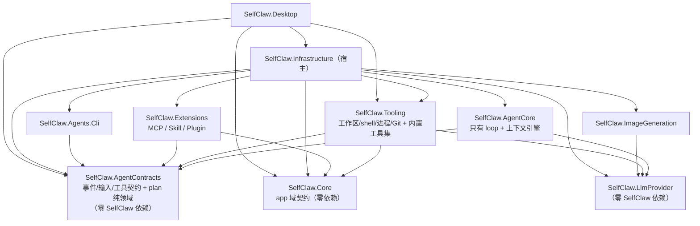

# 模块拆分方案（讨论稿 v3）

> 状态：**待确认，未动手**。
> 已确认：**A1**（LlmProvider 零 SelfClaw 依赖）、**B2**（AgentCore 自建 turn input）、**分阶段**、**全拆**、**TodoToolset/AskUserToolset 归 Tooling**。
> v3 相对 v2 的变化：新增 `SelfClaw.AgentContracts` 契约程序集；`AgentCore` 瘦成"只有 loop + 上下文引擎"；修正 v2 里"Extensions 依赖 AgentCore"这句错话。

## 0. 结论摘要

### 0.1 直接回答你第 2 个问题

v2 里"`Extensions` 会依赖 `AgentCore`"这句话**不准确，而且是我把设计做坏了**。真实情况是：

- 扩展（MCP / Skill / Plugin）需要的**不是** agent loop，而是**"工具契约"这 9 个类型**：
  `DirectToolBinding`、`DirectToolDescriptor`、`DirectToolResult`、`DirectToolBindings`（工厂）、`DirectToolSource`、`ToolCallKind`、`ToolSourceKind`、`ToolCallStatus`、`ToolResultTextLimits`。合计约 150 行。
- 这 9 个类型现在都寄生在 `AgentCore` 的将来地盘里（`Agents/Direct/Tools/Models/*` + `Core/Runtime/Agent/*`），所以 v2 的结论才变成"Extensions → AgentCore"。
- **你的理解完全正确**：应当有一个"能力绑定接口"作为扩展点，任何新能力实现它就接入，因此必然依赖那个契约。我只纠正一点——**这个契约不该放在 `AgentCore` 里，而该独立成一个零依赖的小程序集** `SelfClaw.AgentContracts`。否则"想引用 Tooling 或 Extensions"就会被迫拖进整个 agent loop，与你最初的目标（每模块可单独引用）冲突。

修正后的方向：

```
AgentContracts  ← 事件契约 + 回合输入契约 + 工具契约（零 SelfClaw 依赖）
   ↑        ↑         ↑          ↑
AgentCore  Tooling  Extensions  Agents.Cli     ← 谁都不依赖 loop
```

`AgentCore` 从此只是"loop 的实现"，不是"契约的仓库"。

### 0.2 你第 1 点带来的连带影响（重要）

把 `TodoToolset` / `AskUserToolset` 移到 `Tooling` 之后，**plan（todo）语义的归属必须重新裁决**，因为它现在被 loop 和 todo 工具同时使用：

| 类型 | 现在被谁用 | 若放进 Tooling 会怎样 |
|---|---|---|
| `TodoPlanRules`(186L) | `TodoToolset`（校验）**+ 无 loop 直接调用** | 可进 Tooling |
| `TodoPlanHistory`(78L) | **loop**：`DirectHistoryReplay:162`、`DirectTurnPreparer:182` | 进 Tooling ⇒ **AgentCore → Tooling** |
| `TodoPlanSection`(81L) | **loop**：`DirectCompactionStep:218`、`DirectConversationContext:197/308` | 同上 |
| `TodoWriteItemArgument` | `TodoToolset` | 可进 Tooling |
| `TodoItem` / `TodoPlan` | `TodoPlanSection`/`TodoPlanHistory` + **Desktop** 转录投影 | 进 Tooling ⇒ Desktop → Tooling（已计划） |

也就是说：`plan` 是 loop 与 todo 工具**真正共享的语义**，不是某一方的私产。我试过用端口倒置消掉它，但 `DirectConversationContext` 处理的是"回合内重放单元"（`DirectPromptHistoryUnit.Messages`），端口签名会泄漏 AgentCore 内部类型——为了 4 个调用点引入一个丑陋的端口，不划算。

**结论：把 `plan` 纯领域（`TodoPlanRules` + `TodoPlanHistory` + `TodoPlanSection` + `TodoItem`/`TodoPlan`，约 350 行、零 I/O、纯函数）下沉到 `AgentContracts`**，`TodoToolset` 本体进 `Tooling`。这样：

- 无循环依赖、无端口、无拖拽；
- `AgentContracts` 里出现**唯一的领域逻辑**，而它恰好是 loop 与工具共享的那一块——我会在文档和代码注释里写清这条理由，避免以后有人往契约层扔业务规则。

`ask_user` 没有这个问题：loop 只读 `binding.Descriptor.Kind == ToolCallKind.Ask`，`AskUserRules` 的限额由工具自身持有 → `AskUserRules` + ask_user DTO 干净地进 `Tooling`（Desktop 的审批/转录展示也从 `Tooling` 取）。

### 0.3 项目清单（9 个库 + 桌面 + 测试）

```
SelfClaw.AgentContracts   事件/输入/工具契约 + plan 纯领域   零 SelfClaw 依赖
SelfClaw.LlmProvider      provider 适配                    零 SelfClaw 依赖
SelfClaw.AgentCore        agent loop + 上下文引擎            → AgentContracts, LlmProvider
SelfClaw.Tooling          工作区/shell/搜索/进程/Git + 内置工具 → AgentContracts, LlmProvider, Core
SelfClaw.Extensions       MCP / Skill / Plugin              → AgentContracts, Core
SelfClaw.Agents.Cli       Claude / Codex / OpenCode 子进程    → AgentContracts
SelfClaw.ImageGeneration  生图                              → LlmProvider
SelfClaw.Core             app 域契约（宿主↔Desktop）          零依赖
SelfClaw.Infrastructure   宿主（SQLite/DPAPI/子代理/自动化/组合根）
SelfClaw.Desktop          WPF + WebView2
SelfClaw.Tests            暂不拆
```

### 0.4 工期

| 阶段 | 内容 | v2 估 | v3 估 |
|---|---|---:|---:|
| P0 | 基线与 golden prompt 快照 | 0.5~1 | 0.5~1 |
| P1 | `LlmProvider`（A1） | 2 | 2 |
| P2 | `AgentContracts` + `AgentCore`（B2） | 6~8 | **7~9** |
| P3 | `Tooling`（含 Todo/AskUser 工具集） | 1~1.5 | 1.5~2 |
| P4 | `Extensions` | 2~3 | 2~2.5（不再依赖 loop） |
| P5 | `Agents.Cli` | 1~1.5 | 1~1.5 |
| P6 | `ImageGeneration` | 0.5~1 | 0.5~1 |
| 合计 | | 13~17 | **约 15~19 个工作日** |

`Tooling` 挪到 `Extensions` 之前，因为它不再依赖 `Extensions`（原来 v2 里 `Tooling` 只是被动被宿主引用）；顺序调整后每个 Phase 的依赖都已完成。

---

## 1. 现状盘点（要点）

### 1.1 规模

| 项目 | 文件 | 行数 | TFM |
|---|---:|---:|---|
| `SelfClaw.Core` | 297 | 4,451 | `net10.0`（零 PackageReference） |
| `SelfClaw.Infrastructure` | 265 | 33,101 | `net10.0-windows` |
| `SelfClaw.Desktop` | 255 | 27,994 | `net10.0-windows10.0.19041.0` |
| `SelfClaw.Tests` | 256 | 52,813 | `net10.0-windows10.0.19041.0` |

### 1.2 Infrastructure 里混着的六种职责

| # | 职责 | 代表类型 | 约行数 | 归属 |
|---|---|---|---:|---|
| 1 | provider 协议适配 | `OpenAiProviderAdapter*`、`AnthropicProviderAdapter`、`AiChatOptions`、`ModelOptionReader`、`ProviderStreamIdleGuard`、`OpenAiStreamNormalizingStream`、`RequestUsageAccumulator`、`TurnUsageCostCalculator`、`*ModelListClient` | ~2.4k | **LlmProvider** |
| 2 | provider 解析 + 设置 | `AiChatClientFactory`(214L)、`AiProviderSettingsService`(705L)、`AiProviderSecrets`、`AiProviderCatalog`、`SqliteAiProviderRepository` | ~1.4k | 宿主 |
| 3 | HTTP 出口 | `AiProviderHttpClientProvider`(263L) | ~0.3k | LlmProvider（端口化） |
| 4 | agent loop + 上下文引擎 | `DirectAgentChatRuntime`、`DirectTurnRun`(458L)、`DirectTurnPreparer`、`DirectEventTranslator`、`NoProgressGuard`、`Context/*`(2.5k) | ~5.4k | **AgentCore** |
| 5 | 能力组装 + 工具集 | `DirectTurnCapabilityResolver`(433L)、4 个 `*CapabilitySource`(1.5k)、`WorkspaceAgentToolset`、`SkillRuntimeToolset`、`McpToolAdapter`、`Workspace*`/`Processes`/`Git`(3.9k) | ~5.5k | Tooling + Extensions + 宿主 |
| 6 | 应用基础设施 | `Data/Sqlite`(5.7k)、`Extensions`(4.5k)、`Subagents`(2.3k)、`Attachments`、`Automation`、`Security`、`Options`、`Agents/Cli`(2.4k) | ~17k | 宿主 / Extensions / CLI |

### 1.3 已经存在的"好缝"

Loop 真正硬耦合外部世界的只有三处：`IAiChatClientFactory.PrepareAsync(modelProfileId)`（→SQLite+DPAPI）、`DirectTurnCapabilityResolver`（→扩展表+MCP+插件）、`DirectTokenCounter`（无 I/O）。审批、提问、steer、附件、压缩策略、续写屏障**全部已是注入抽象**——这是 B2 能落地的前提。

---

## 2. 目标形态

### 2.1 项目图



**关键：没有任何模块依赖 `AgentCore`。** `AgentCore` 是叶子（只被宿主引用），这意味着 loop 可以被替换、可以不在场，而工具与扩展照常编译。

### 2.2 依赖硬规则（写成断言，§7.1）

| 程序集 | 允许的 SelfClaw 引用 | 允许的关键第三方包 | 禁止 |
|---|---|---|---|
| `Core` | 无 | 无 | 一切 |
| `AgentContracts` | **无** | M.E.AI.Abstractions | SQLite、ProtectedData、Hosting、ML.Tokenizers、MCP、WPF |
| `LlmProvider` | **无** | M.E.AI(+OpenAI)、Anthropic | SQLite、ProtectedData、Hosting、ML.Tokenizers、MCP、WPF |
| `AgentCore` | `AgentContracts`、`LlmProvider` | M.E.AI、ML.Tokenizers(+Data) | SQLite、ProtectedData、MCP、WPF、**Core** |
| `Tooling` | `AgentContracts`、`LlmProvider`、`Core` | M.E.AI | SQLite、MCP、WPF、**AgentCore** |
| `Extensions` | `AgentContracts`、`Core` | MCP.Core、M.E.AI | SQLite、ProtectedData、WPF、**AgentCore** |
| `Agents.Cli` | `AgentContracts` | M.E.AI | SQLite、WPF、**AgentCore** |
| `ImageGeneration` | `LlmProvider` | M.E.AI、OpenAI | SQLite、WPF |

`Tooling → LlmProvider` 只为 `ToolImageCapability` / `ToolImageDelivery`（`WorkspaceAgentToolset` 读图能力）；LlmProvider 零依赖，所以这条边不带来任何拖拽成本。

### 2.3 各项目内容（文件级）

**`SelfClaw.AgentContracts`（新增，约 1.5k 行，零 SelfClaw 依赖）**

```
Events/           AgentStreamEvent 全家族(24 文件) + AgentRunStatus/RunCompletionStatus/
                  ToolCallKind/ToolCallStatus/ToolSourceKind/CliAgentKind
Input/            AgentTurnInput, AgentMessage, AgentMessageSegment, AgentAttachment,
                  AgentToolRun, AgentTurn, AgentCompaction, AgentUsage, AgentWorkspace,
                  AgentDefinition, AgentOrigin, AgentCapabilityCeiling, AgentCompletionBatch
Input/Ports/      IAgentInputSession, IAgentSteering, IAgentToolApprovalGate,
                  IAgentQuestionGate, IAgentToolExecutionBarrier
Tools/            AgentToolBinding, AgentToolDescriptor, AgentToolResult, AgentToolBindings,
                  AgentToolSource, ToolResultTextLimits
Tools/Ports/      IAgentToolSource（见 §5）
Plan/             TodoPlanRules, TodoPlanHistory, TodoPlanSection, TodoItem, TodoPlan
Runtime/          IAgentChatRuntime, AgentExecutionMode, DirectCompressionPolicy
```

> `AgentContracts` 里有 `Plan/` 是唯一的领域逻辑，理由见 §0.2。

**`SelfClaw.AgentCore`（约 4.5k 行，只有 loop + 上下文引擎）**

```
Direct/           DirectAgentChatRuntime, DirectTurnRun, DirectTurnPreparer, DirectTurnRunFactory,
                  DirectEventTranslator, NoProgressGuard, DirectLoopMessages, DirectTurnLeaseDisposer,
                  TurnUsageReporter, DirectTurnPolicy, DirectCapabilityRules, TurnDiagnostics,
                  DirectTurnLeaseScope, AgentTurnInputValidator
Direct/Context/   DirectConversationContext, DirectHistoryReplay, DirectSystemPrompt, DirectTokenCounter,
                  DirectPromptMeter, DirectCompactionPlanner, DirectCompactionStep, DirectContextCompressor,
                  CapabilitySections, InTurnCompactionAllowance, Models/*
Direct/Tools/     DirectToolInvoker（唯一的工具执行缝：审批 → barrier → 执行 → 故障预算）
Abstractions/     IDirectTokenCounter, IAgentAttachmentReader, IAgentModelResolver,
                  IAgentCapabilityResolver, AgentCapabilityLease（系统段 + 工具 + 消息调整 + lease 范围）
Dispatcher/       DispatchingAgentChatRuntime, IAgentRuntimeAdapter
Usage/            AgentUsageAccumulator
AgentCoreServiceCollectionExtensions
```

**从 AgentCore 移出**（依你的第 1 点）：

| 类型 | 新家 |
|---|---|
| `TodoToolset`(98L) | `Tooling/Tools/` |
| `AskUserToolset`(162L)、`AskUserRules`(135L)、`AskUser*Argument` | `Tooling/Tools/` |
| `DirectTurnCapabilityLease` | 改名 `AgentCapabilityLease`，留 `AgentCore`（loop 的租约，含 `Tools`/`Bindings`） |
| `DirectTurnCapabilityResolver`(433L) | 宿主（组合 4 个来源，实现 `IAgentCapabilityResolver`） |

**`SelfClaw.Tooling`（约 2.8k 行）**
`Tools/Workspace/*`(1835L)、`Processes/*`(616L)、`Git/*`(1449L)、`WorkspaceAgentToolset`(287L)、`TodoToolset`、`AskUserToolset` + `AskUserRules`、`WorkspaceImageLimits`；契约 `IWorkspaceToolService`/`IWorkspaceShellPreferenceSource`/`Workspace*` 沿用 Core（零依赖）。

**`SelfClaw.Extensions`（约 4.5k 行）**
`ExtensionCatalog`(307L)、`ExtensionPackageInstaller`(718L)、`ExtensionSettingsService`(590L)、`Skills/*`、`Plugins/*`、`Mcp/*`(1069L)、`UserSkillDiscoveryService`、`CapabilityContentCache`、`PluginVersionLeaseManager`；由宿主搬入 `{Plugin,Skill,Mcp}CapabilitySource`(816L)、`SkillRuntimeToolset`(396L)、`SkillScriptRunner`(173L)、`SkillResourceFormatter`(114L)、`McpToolAdapter`(101L)、`McpToolResultFormatter`(165L)、`SkillTokenParser`。

**`SelfClaw.Agents.Cli`（约 2.4k 行）** — 无变化（`CliAgentChatRuntime` + adapters + parsers + process）。

**`SelfClaw.ImageGeneration`（约 0.9k 行）** — 无变化。

**`SelfClaw.Core`（缩到约 2.2k 行）** — 保留 app 域（Conversations/Inputs/Workspace/Git/Automation/Subagents/Usage/Extensions/Network）；迁出 AiProviders→LlmProvider、ImageGeneration→ImageGeneration、Runtime/{Agent,Requests,Approvals,Questions,Tooling} + Models/Tooling→AgentContracts。

---

## 3. 契约层设计（B2 的落地点）

### 3.1 工具契约（回答你问题的核心）

任何新能力只需要实现这一个形状：

```csharp
// AgentContracts/Tools/AgentToolBinding.cs —— 现在叫 DirectToolBinding，10 行
public sealed record AgentToolBinding(
    AIFunction Tool,                        // M.E.AI，直接就是 provider 能看见的函数
    AgentToolDescriptor Descriptor,         // Kind / SourceKind / SourceId / DisplayName
    bool RequiresApproval = false,
    string? TransportSummary = null,
    string? AnnotationsJson = null);

public sealed record AgentToolDescriptor(
    ToolCallKind Kind,                      // Other/Read/Edit/Run/Search/List/Plan/Ask
    ToolSourceKind? SourceKind = null,      // BuiltIn/Mcp/Skill/Plugin
    string? SourceId = null,
    string? DisplayName = null);

// 工具返回值
public sealed record AgentToolResult(
    ToolCallStatus Status, string Summary, JsonElement Content, string? Detail,
    IReadOnlyList<AIContent>? ModelContents = null);
```

能力提供方（三条路，都是同一个契约）：

| 提供方 | 实现的东西 | 产出的东西 |
|---|---|---|
| `Tooling` | 直接 `AIFunctionFactory` 绑定 | `IReadOnlyList<AgentToolBinding>` |
| `Extensions`（MCP） | 用 `McpToolAdapter` 包 MCP tool | 同上 |
| `Extensions`（Skill/Plugin） | 用 `SkillRuntimeToolset` 包脚本/资源 | 同上 |
| 宿主（子代理） | `SubagentCapabilitySource` | 同上 |
| **未来任何项目** | 实现 `IAgentToolSource`（§5）| 同上 |

若要贡献系统提示段或消息改写，`AgentCapabilityLease` 里的 `SystemInstructions` + `MessageAdjustments` 就是那两个槽位——Skill 现在正是这么做的（`skills.MessageAdjustments`）。

### 3.2 回合输入契约

```csharp
public sealed record AgentTurnInput(
    Guid TurnId,
    Guid ConversationId,                    // 对 AgentCore 是不透明标识
    AgentOrigin Origin,                     // Interactive/Subagent/Continuation/Automation
    AgentDefinition Agent,                   // Instructions + ToolPolicy + Plugin/Skill/Mcp/Subagent ids
    AgentWorkspace? Workspace,              // 只要 (RootId, RootPath)
    Guid? ModelProfileId,
    ToolPermissionMode PermissionMode,
    IReadOnlyList<AgentMessage> Messages,
    IReadOnlyList<AgentTurn> Turns,
    IReadOnlyList<AgentToolRun> ToolRuns,
    AgentCompaction? Compaction,
    AgentCapabilityCeiling? Ceiling,
    AgentCompletionBatch? Completions,
    IAgentInputSession? InputSession,
    IAgentSteering? Steering,
    IAgentToolApprovalGate? Approval,
    IAgentQuestionGate? Questions,
    IAgentToolExecutionBarrier? Barrier);

public sealed record AgentMessage(
    Guid Id, Guid TurnId, long Sequence, AgentMessageRole Role, string Markdown,
    AgentMessageStatus Status,
    IReadOnlyList<AgentAttachment>? Attachments,
    IReadOnlyList<AgentMessageSegment>? Segments);

public sealed record AgentAttachment(Guid Id, string FileName, string MediaType,
    string StoragePath, long ByteLength);

public sealed record AgentToolRun(
    Guid Id, Guid? MessageId, string ToolName, string ArgumentsJson,
    AgentToolRunStatus Status, string? ResultSummary, string? ResultContent,
    string? CallId, ToolCallKind Kind, ToolSource? Source);

public sealed record AgentTurn(Guid Id, AgentTurnStatus Status);          // 只用于重放判定
public sealed record AgentCompaction(long ThroughSequence, string Summary, Guid? ThroughToolRunId);
```

### 3.3 字段来源对照

| 现在 | 之后 | 映射者 | 依据（已逐文件核实） |
|---|---|---|---|
| `MessageRecord`(22 字段) | `AgentMessage`(8) | 宿主 `AgentTurnInputMapper` | `DirectHistoryReplay` 只读 Id/TurnId/Sequence/Role/Markdown/Status/Attachments/Segments |
| `ConversationTurnRecord`(9) | `AgentTurn`(2) | 同上 | 只用 `Id`、`Status==Blocked`、`ConversationId` 归属校验 |
| `ToolExecutionRecord`(18) | `AgentToolRun`(11) | 同上 | 重放只要 Id/MessageId/ToolName/ArgumentsJson/Status/Result*/CallId |
| `ConversationCompactionRecord`(11) | `AgentCompaction`(3) | 同上 | prompt 只用 `ThroughSequence`/`Summary`/`ThroughToolRunId` |
| `ConversationInputBatch`/`Item` | `AgentInputBatch`/`Item` | Desktop 输入服务 | 事件回传再映射回去 |
| `TurnUsage`(16) | `AgentUsage`(≈12) | Desktop recorder | 落库时映射 |
| `WorkspaceRoot`(11) | `AgentWorkspace`(2) | 同上 | `WorkspaceAgentToolset` 只用 `RootPath`（1 处，已核实）；Git/Worktree 元数据留宿主 |
| `AgentRuntimeDefinition`(11) | `AgentDefinition`(11) | 同上 | 纯定义，几乎原样 |
| `SubagentCompletionBatch` | `AgentCompletionBatch` | 同上 | 只需 taskId/摘要/失败标志 |

### 3.4 事件载荷换型（P2 一次做完）

| 事件 | 现在 | 之后 | 受影响消费者 |
|---|---|---|---|
| `ContextCompactionCompletedEvent` | `ConversationCompactionRecord` | `AgentCompactionRecord` | `ConversationTurnRecorder`(473L)、`DesktopTurnFinalizer` |
| `InTurnContextCompactionCompletedEvent` | `ConversationCompactionRecord?` | `AgentCompactionRecord?` | 同上 + `ConversationTurnFinalizerBuilder` |
| `TurnInputBoundaryEvent` | `ConversationInputBatch, TurnUsage?` | `AgentInputBatch, AgentUsage?` | `ConversationInputPublisher`、recorder |
| `UsageReportedEvent` / `UsageProgressEvent` | `TurnUsage` | `AgentUsage` | recorder、`AgentActivityCoordinator`、用量仪表盘 |
| `ToolCallStartedEvent` 的枚举 | `Core.Runtime.Agent.*` | `AgentContracts.Events.*` | recorder、转录投影 |

### 3.5 正确性判据：golden prompt 逐字节

B2 真正的风险不是编译错误，而是**映射改错字段语义 → prompt 悄悄变了 → 模型行为变但测试全绿**。唯一的可靠判据：

1. P0 从现有夹具（`SelfClaw.Tests/Infrastructure/Agents/Direct/*` 14 文件 + `.../Context/*` 12 文件，已覆盖 steer / 附件 / todo / 回合内压缩 / 三种图片投递）抽 N 份历史快照；
2. 用现代码 `DirectHistoryReplay.BuildUnits + Compose + DirectSystemPrompt.BuildFixedText + TodoPlanSection.Build` 生成 golden，落盘 `SelfClaw.Tests/Agents/PromptGolden/*.txt`；
3. P2 之后用新契约 + 映射层再生成，`Should().Be(golden)` 逐字节断言。

同一套 golden 也保护 P3（工具描述文本）与 P4（Skill 注入段）。

### 3.6 B2 的必改清单（代价明细）

| 类别 | 具体 | 量级 |
|---|---|---|
| 新契约 | `AgentContracts/*`（Events 24 + Input 13 + Ports 6 + Tools 6 + Plan 5 + Runtime 3） | 新增 ~1.5k 行（多为搬家） |
| 映射层 | `AgentTurnInputMapper` + `AgentCompactionRecordMapper` + `AgentUsageMapper` | 新增 ~350 行 + 测试 |
| 消费方改写 | `DirectTurnPreparer`、`DirectTurnRun`、`DirectHistoryReplay`、`DirectCompactionStep`、`DirectSystemPrompt`、`DirectPromptMeter`、`DirectConversationContext`、`DirectContextCompressor` 入参类型 | ~8 文件、约 120 处 |
| 事件载荷 | 5 个事件 + `TurnUsageAccumulator` | ~6 文件 |
| Desktop 适配 | `ConversationTurnRecorder`(473L)、`ConversationInputPublisher`、`AgentActivityCoordinator`、`StreamingAssistantContent`、`TerminalBlockAligner`、`SubagentContinuationExecutor`、`AutomationRunExecutor` | ~7 文件 |
| 测试夹具 | `Direct/*`(14) + `Context/*`(12) 里的 `MessageRecord`/`ToolExecutionRecord` 构造 | ~20 文件重写 |

**B2 不是搬家，是一次小规模领域建模。** 你已经选了，我按它排期，但这条代价必须摆在明面上：它占整个拆分工程约一半的工作量。

---

## 4. A1 的具体设计（LlmProvider 零依赖的三个口子）

> `LlmProvider` 内部的**提供商抽象**另见 `docs/llm-provider-abstraction-design.md`（厂商为一等概念、协议按能力集合声明、厂商专有参数走声明式参数表；设置页 DTO 与仓储**留在宿主不进库**）。那里把 P1 从 2 天调到 5~6 天。

| 口子 | 现状 | 改法 |
|---|---|---|
| **HTTP 出口** | `AiProviderHttpClientProvider` 直接吃 `INetworkProxySource` + `NetworkProxySettings` 算 handler 指纹 | `IAiProviderTransport { string DescribeCurrentExit(); HttpMessageHandler CreateHandler(); }`；宿主 `NetworkProxyTransport` 包住 `NetworkProxyHttpHandler`（不改 `docs/network-proxy-design.md` 任何语义）；缺省 `DirectTransport`（`SocketsHttpHandler{UseProxy=false}`），独立引用开箱可用 |
| **成本计算** | `TurnUsageCostCalculator.ComputeCostUsdMicros(TurnUsage, AiModelConfiguration?)` | `LlmCostCalculator.ComputeUsdMicros(LlmTokenUsage, AiModelConfiguration?)`，`LlmTokenUsage` 是 4 个计数；`TurnUsage → LlmTokenUsage` 由 `TurnUsageReporter` 映射 |
| **模型/密钥解析** | `AiChatClientFactory.PrepareAsync(modelProfileId)` 直接读 SQLite + DPAPI | 宿主 `AiChatClientResolver.ResolveAsync` → `AiProviderClientRequest`；LlmProvider `AiChatClientFactory.Create(request, pipeline)` 纯同步。`NonSensitiveLoggerFactory`（永久屏蔽 M.E.AI Trace）**必须原样留在 LlmProvider 侧** |

设置页 DTO（`AiModelProfile`/`AiModelView`/`AiProviderView`/`SaveProviderCommand`…）**留在宿主**：它们是"配置编辑器"的契约，不是 LLM 调用契约。库只收已解析的 `LlmConnection` + `LlmModel` + 已解密凭据，细节见 `docs/llm-provider-abstraction-design.md` §0。设置服务**实现**（`AiProviderSettingsService` 705L）同样留宿主。

---

## 5. 全拆所需的宿主端口（修正版）

| 模块 | 新端口 | 现状耦合 | 备注 |
|---|---|---|---|
| `AgentCore` | `IAgentModelResolver`（`Guid? modelProfileId` → `AiProviderClientRequest`） | `IAiChatClientFactory.PrepareAsync` | 唯一定"回合用哪个模型"的地方 |
| `AgentCore` | `IAgentCapabilityResolver`（`AgentTurnInput` → `AgentCapabilityLease`） | `IDirectTurnCapabilityResolver` | 契约在 AgentCore（loop 的租约），实现在宿主 |
| `AgentCore` | `IAgentAttachmentReader`（`IReadOnlyList<AgentAttachment>` → `AI内容`） | `IAttachmentContentReader` | 现在吃 `MessageRecord`，改吃 `AgentAttachment` |
| `Extensions` | `IExtensionPackageStore`、`IMcpServerStore`、`IExtensionContentRoots` | `IExtensionPackageRepository`、`StoragePaths`(3 处) | **不再需要 AgentCore** |
| `Agents.Cli` | `ICliAgentSessionStore` | `SqliteCliAgentSessionStore` | 对话 id 仍是 `Guid`（Contracts 里的不透明标识） |
| `ImageGeneration` | 复用 `IAgentModelResolver` 同源的写入端口 | `IAiProviderRepository` + `ISecretProtector` | 图片兜底（第一个 enabled 的 `OpenAIImages`）**留宿主实现**，与聊天兜底（`desktop-default`）语义不同，不可合并 |

`Tooling` 不需要新端口：`IWorkspaceToolService` 契约自持、实现自带；`IWorkspaceShellPreferenceSource` 仍由 Desktop 覆盖（现逻辑）。

---

## 6. 迁移路线

### P0 — 基线与 golden 快照（0.5~1 天）
1. 建 9 个空项目 + 加入 `SelfClaw.slnx`（`Directory.Packages.props` 已集中版本，新项目不写版本）；
2. 落 `SelfClaw.Tests/Architecture/ModuleBoundaryTests.cs`（§7.1），先 `Skip`；
3. **落 golden prompt 快照**（§3.5）并让它在当前代码上全绿；
4. 记录基线：测试通过数 + Direct 手工冒烟录像。

### P1 — `LlmProvider`（A1，2 天）
`git mv` 迁移；`AiChatClientFactory` 拆两半；`IAiProviderTransport`；`LlmCostCalculator` 标量化；`AddSelfClawLlmProvider()`。
**验证**：单项目 `dotnet build` 通过；`Tests/Infrastructure/AiProviders` 18 文件全绿；断言 LlmProvider 零 SelfClaw 引用。

### P2 — `AgentContracts` + `AgentCore`（B2，7~9 天，最重）
建议内部两步提交：
1. **第一步：纯搬家**——把事件/输入/工具/plan 类型搬到 `AgentContracts`，`Direct*` 改名为 `Agent*`，**不改字段、不改载荷**。此时代码仍能编译，边界断言部分转绿（Tooling/Extensions 尚未建）。
2. **第二步：契约换型**——引入 `AgentTurnInput` 等新输入契约 + 映射层 + 事件载荷换型 + 8 个消费方 + Desktop 7 个消费者 + 20 个测试夹具。
`IDirectModelResolver`→`IAgentModelResolver`、`IAgentCapabilityResolver`、`IAgentAttachmentReader` 三个端口；`DirectTurnCapabilityResolver` 留宿主。
**验证**：golden prompt 逐字节一致（最重要）；`Tests/Infrastructure/Agents/Direct`(14) + `.../Runtime` 全绿；Desktop 编译 + 手工冒烟（文本/thinking/工具/审批/steer/取消/压缩/读图）。

### P3 — `Tooling`（1.5~2 天）
`Tools/Workspace` + `Processes` + `Git` + `WorkspaceAgentToolset` + `TodoToolset` + `AskUserToolset` + `AskUserRules` + `WorkspaceImageLimits`。
**验证**：`Tests/Infrastructure/Tools`、`Processes`、`Git`、`Agents/Direct/Tools`(AskUser/Todo/Workspace 三组) 全绿；工具描述文本 golden 不变。

### P4 — `Extensions`（2~2.5 天，风险次高）
MCP/Skill/Plugin 全量 + 3 个能力源 + 3 个新端口 + `IExtensionContentRoots` 替换 `StoragePaths`。
**验证**：`Tests/Infrastructure/Extensions` 全绿 + 插件安装/启用/降级手工冒烟 + `docs/direct-extensions-system-design.md` 逐条核对。

### P5 — `Agents.Cli`（1~1.5 天）
`CliAgentChatRuntime` + adapters + parsers + process；`ICliAgentSessionStore` 端口。
**验证**：`Tests/Infrastructure/Agents/Cli` 全绿 + 三个 CLI 各一轮（含无 CLI 时的指引失败路径）。

### P6 — `ImageGeneration`（0.5~1 天）
4 个实现 + 2 个接口 + 11 个 model；`IImageGenerationService` 改吃 profile 解析端口。
**验证**：`Tests/Infrastructure/ImageGeneration` + 工作台烟测（6 分钟超时、`jobId` 取消）。

**回退**：每 Phase 至少两个提交（①纯 `git mv` 不改内容 ②改名/可见性/逻辑），可整体 revert。

### 文档同步（每个 Phase 必做）

| 文档 | 需改内容 |
|---|---|
| `docs/pipeline-architecture.md` | §2 全链路节点名、§8 所有权表、文末"证据文件"全部路径 |
| `docs/runtime-execution-flow.md` | 调用链里的类型出处 |
| `AGENTS.md` | "领域契约放 `SelfClaw.Core/Interfaces/<Feature>/`" 在 B2 后不再对所有模块成立 |
| `docs/direct-{extensions,subagent,tool-result-image,context-compaction,ask-user,todo-plan}-design.md` | 类名与文件位置 |

---

## 7. 验收标准

### 7.1 边界断言（P0 落盘）

```csharp
[Fact] Contracts与LlmProvider_零SelfClaw依赖()
{
    SelfClaw("SelfClaw.AgentContracts").Should().BeEmpty();
    SelfClaw("SelfClaw.LlmProvider").Should().BeEmpty();
}

[Fact] 没有任何模块依赖AgentCore()   // loop 是叶子
    => Projects().Where(p => SelfClaw(p).Contains("SelfClaw.AgentCore"))
        .Should().BeEquivalentTo("SelfClaw.Infrastructure", "SelfClaw.Tests");

[Fact] Tooling与Extensions与Cli_不依赖AgentCore()
{
    SelfClaw("SelfClaw.Tooling").Should().NotContain("SelfClaw.AgentCore");
    SelfClaw("SelfClaw.Extensions").Should().NotContain("SelfClaw.AgentCore");
    SelfClaw("SelfClaw.Agents.Cli").Should().NotContain("SelfClaw.AgentCore");
}

[Fact] AgentCore_不引用Core_SQLite_或WindowsDLL()
{
    SelfClaw("SelfClaw.AgentCore").Should().BeEquivalentTo(
        "SelfClaw.AgentContracts", "SelfClaw.LlmProvider");
    External("SelfClaw.AgentCore").Should().NotContain(new[]{
        "Microsoft.Data.Sqlite", "System.Security.Cryptography.ProtectedData",
        "Microsoft.Web.WebView2", "ModelContextProtocol.Core" });
}

[Fact] LlmProvider_不含持久化或Windows依赖() { /* 同 v2 */ }
```

### 7.2 "可单独引用"的活证据
- 每个模块 `dotnet build <module>/<module>.csproj` 单项目通过；
- 新增 `samples/LlmProviderProbe`（控制台 ~20 行：endpoint+key+model → 打印流式回复）；
- 新增 `samples/AgentLoopProbe`（~40 行：LlmProvider + AgentCore + 假工具源 → 跑一轮带工具调用的 turn，**用不到 Core / SQLite / Tooling**）。这条 probe 是 B2 价值的最直接证明。

### 7.3 行为不回归（每阶段手工清单）
1. 一轮 Direct：文本流 + thinking + 工具调用 + 审批（允许/拒绝）+ 终态映射；
2. steer：回合内插入、审批被 `Superseded`、`SkillRequiresNewTurn`；
3. 压缩：回合开始 + 回合内，事件顺序 `TriggerResolved → Started → Compacting → Completed`；
4. 读图：Native / FollowUpUserMessage / Unsupported；
5. `todo_write`：计划段注入、被摘要覆盖时的淘汰、旧快照 elision；
6. `ask_user`：`FullAccess` 下同样阻塞、16 次上限、自定义 "Other" 拒绝；
7. 取消：用户取消抛 `OperationCanceledException`；provider 侧取消 → `Failed` + `ExternalCancellationMessage`；
8. 日志：M.E.AI Trace 仍被屏蔽；
9. 用量与成本：`UsageReported`/`UsageProgress` 与落库口径不变；
10. 队列：`TurnInputBoundary` 后宿主 `WaitForCommitAsync` 语义不变。

### 7.4 迁移专属测试
- **golden prompt**（P0 落盘，P2/P3/P4 复用）；
- **映射层 round-trip**：`MessageRecord → AgentMessage → DirectPromptHistoryUnit`，含边界（`CorrelationId==null` 的兜底 `Id.ToString("D")`、`Blocked` 回合剔除、`Interrupted` 保留）；
- **DI 覆盖断言**：`IDirectCompressionPolicySource`/`INetworkProxySource`/`IWorkspaceShellPreferenceSource` 最终解析到 Desktop 实现。

---

## 8. 风险与回退

| 风险 | 等级 | 对策 |
|---|---|---|
| **prompt 漂移**（B2 映射改错语义，模型行为悄悄变） | 高 | golden prompt 逐字节断言；P2 第一步只搬不改 |
| `AgentCli`/`Tooling` 不引用 Core 后发现某个小类型非它不可 | 中 | 契约里补最少字段；**禁止**回头引用（否则 B2 白做） |
| `AgentContracts` 被当成"什么都能放"的垃圾桶 | 中 | 只有 `Plan/` 允许领域逻辑，且必须写清"loop 与 todo 工具共享"的理由；其余只放 record/interface |
| `internal` → 跨程序集被迫批量 `public` | 中 | 先列"跨模块可见清单"再动手；其余保 `internal` + `<InternalsVisibleTo Include="SelfClaw.Tests" />` |
| Extensions 拆分牵动安装/启用/降级与 MCP 生命周期 | 高 | 单独一轮冒烟；设计文档逐条核对 |
| DI 覆盖语义破坏（3 处"后注册胜出"） | 高 | 固化顺序 `LlmProvider → AgentContracts? → AgentCore → Tooling → Extensions → Cli → ImageGeneration → Infrastructure → Desktop` + 断言测试 |
| 项目数从 4 涨到 10 | 中 | 若 P4 后感觉过碎，可把 `Tooling + Extensions` 合并；先拆后并不难，反向很难 |

---

## 9. 明确不做的事

1. **不改行为**：compaction 策略、事件顺序、终态映射、审批/steer 语义、图片投递形状、`todo_write` 的 prompt 形态。
2. **不重构 `plan` 的重放机制**（现在 loop 直接读 plan 段并淘汰旧快照，是已知的设计弯曲，但改它会动 prompt → 不在这一轮）。
3. **不拆测试项目**。
4. **不动构建/发布配置**（单文件发布、asset 拷贝、图标、mutex 单实例）。
5. **不引入新框架**（不换 DI、不引入 MediatR、不做插件化 AgentCore）。
6. **不实现 `IEmbeddingGenerator`**：LlmProvider 只留 adapter 模式的扩展点。
7. **不为"少一个项目"放松断言**：若两模块拆不开，宁合并也不放松 §7.1。

---

## 10. 仍需你确认

1. 新增 `SelfClaw.AgentContracts`（第 10 个项目）—— 接受吗？命名用 `SelfClaw.AgentContracts` 还是 `SelfClaw.Agent.Contracts`？
2. `plan` 纯领域（`TodoPlanRules`/`TodoPlanHistory`/`TodoPlanSection`/`TodoItem`/`TodoPlan`）下沉到 `AgentContracts` —— 接受吗？（这是让 `TodoToolset` 能进 `Tooling` 且 `AgentCore` 不反向依赖 `Tooling` 的唯一零风险方案）
3. 设置页 DTO 搬进 `LlmProvider`，OK？
4. 九个模块统一 `net10.0`（除宿主与 Desktop），OK？
5. `SelfClaw.Infrastructure` 保留原名（推荐）还是改名 `SelfClaw.Host`？
6. 约 **15~19 个工作日**、且 P2（7~9 天）期间 Direct 主干不宜并行开发 —— 能接受吗？建议排在你不频繁改 agent loop 的窗口。

确认后我从 P0 开始，每阶段汇报"编译 + 测试 + golden/冒烟"三项结果再进下一步。
